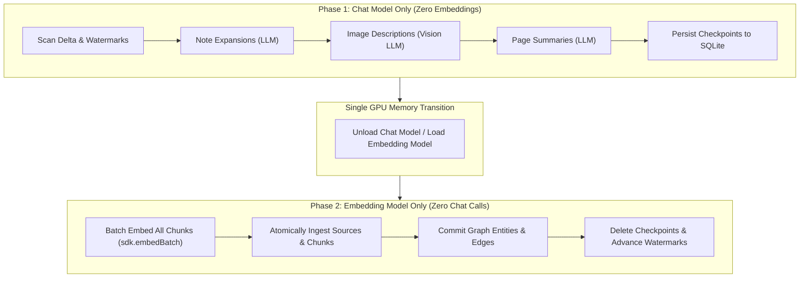

# AGENTS.md: Developer & Agent Guide to Shale

Welcome to **Shale**. This document provides AI agents and human contributors with a complete architectural breakdown, operational guide, and development manual for understanding, modifying, and extending the codebase.

---

## 1. Executive Summary & Product Vision

### What is Shale?
**Shale** is a local-first personal knowledge intelligence layer and cognitive memory engine for AI assistants and power users. It unifies disparate streams of personal data—Obsidian markdown vaults, browser browsing sessions/tabs, images, technical diagrams, and document collections—into an integrated **hybrid search and knowledge graph database**.

### Core Tenets
1. **Local-First & Privacy Preserving**: Runs entirely on your machine. All storage is local SQLite (`bun:sqlite`), vector indexing is powered locally by `sqlite-vec`, and lexical search runs on SQLite FTS5.
2. **Two-Phase Local GPU Optimization**: Built specifically to avoid VRAM thrashing on consumer hardware. Local LLMs (e.g. Ollama or vLLM running on an 8GB–24GB GPU) cannot rapidly alternate between large Chat models and Embedding models without severe model reload latency. Shale enforces strict phase separation: all Chat model operations run first (Phase 1, zero embeddings), followed by a single model transition and batch embedding of all accumulated chunks (Phase 2, zero chat calls).
3. **Verbatim vs. Synthetic Chunk Typing**: Differentiates strictly between raw source text (`verbatim`) and AI-generated text (`synthetic` expansions, summaries, narratives, conceptual interpretations).
4. **Multimodal by Design**: Ingests notes, web pages, and images. Images are analyzed using multimodal vision models, decomposing visuals into layout/visual components (`verbatim`) and underlying conceptual meaning (`synthetic`).
5. **Modular Extension Architecture**: Capabilities are isolated as self-contained extensions with schema-validated settings, crash recovery checkpoints, cron jobs, and a type-safe cross-extension message bus.

---

## 2. Technology Stack

- **Runtime & Package Manager**: [Bun](https://bun.sh/) ($\ge$ 1.1)
- **Language**: TypeScript (strict mode)
- **Database**: `bun:sqlite` with:
  - `sqlite-vec` (SIMD-accelerated 4096-dimensional vector search)
  - `fts5` with porter stemming (lexical BM25 full-text search)
  - `STRICT` table mode and foreign keys enabled
- **NLP / Utilities**: `stopword` for keyword extraction and stopword stripping
- **CLI & Configuration**: `@clack/prompts`, `commander`
- **Testing**: `bun:test`

---

## 3. Directory Layout & Architecture

```
shale/
├── AGENTS.md                   # This guide
├── EXTENSION_SYSTEM.md         # Comprehensive extension system specification
├── package.json                # Project dependencies, exports, and npm scripts
├── bun.lock                    # Bun lockfile
│
├── lib/                        # Low-Level Core & Host Infrastructure
│   ├── db-init.ts              # SQLite connection, schema creation, migrations, triggers
│   ├── db.ts                   # Core database operations, types, and strict transactions
│   ├── ai.ts                   # Direct OpenAI-compatible LLM & Embedder HTTP clients
│   ├── messages.ts             # Cross-extension message bus engine (MessageBus)
│   ├── messages.types.ts       # Type-safe built-in channels & request/response schemas
│   ├── extension.ts            # Extension manifest validation and schema types
│   └── ingest.types.ts         # Ingest queue types and validation
│
├── sdk/                        # Public Extension SDK Layer (@shale/sdk)
│   ├── index.ts                # ShaleSDK class, ambient proxy exports, factory functions
│   ├── types.ts                # SDK public type definitions (chunks, search, sources)
│   ├── ingest.ts               # Atomic source and chunk ingestion API
│   ├── search.ts               # Hybrid, Vector, and BM25 search engines
│   ├── context.ts              # Context hydrator (resolves chunk + source + graph neighborhood)
│   ├── graph.ts                # Knowledge graph operations (entities and directed edges)
│   ├── embed.ts                # Vector embedding client and dimensional normalization
│   ├── checkpoint.ts           # Crash recovery checkpoint manager
│   ├── state.ts                # Extension state and watermark store
│   ├── settings.ts             # Extension settings reader/writer with schema validation
│   └── messages.ts             # Scoped cross-extension messaging client (ExtensionMessages)
│
├── main/                       # Host Runtime & Daemon
│   ├── index.ts                # Bun HTTP server (/ingest on port 7425), cron scheduler
│   ├── load-extensions.ts      # Extension loader, setup runner, manifest scanner
│   ├── ingest-router.ts        # Routes incoming ingest queue payloads to subscriber extensions
│   └── ingest-queue.ts         # Memory buffer and queue for async ingest payloads
│
├── extensions/                 # Pluggable Extensions
│   ├── obsidian/               # Obsidian vault sync, atomic note expansion, markdown chunking
│   ├── browser/                # Web visits, session narrative aggregation, history/bookmarks
│   ├── process-image/          # Multimodal image analysis (verbatim layout + synthetic meaning)
│   ├── source-linker/          # Cross-source entity citation and semantic graph linker
│   └── db-backup/              # SQLite hot database backup and automated rotation
│
├── scripts/                    # Developer Tooling & CLI Utilities
│   ├── settings.ts             # Interactive and headless settings CLI (`bun run settings`)
│   ├── serve-visualizer.ts     # Local HTTP server for knowledge graph visualizer
│   └── browser-chrome-extension/# Chrome browser extension for capturing web visits
│
├── visualizer/                 # Frontend UI for inspecting sources, chunks, and graph
│   └── index.html              # Interactive 2D/3D force graph and chunk browser
│
└── tests/                      # 17 Comprehensive Test Suites (246 tests)
    ├── db-schema.test.ts
    ├── search.test.ts
    ├── sdk.test.ts
    ├── cross-extension-messaging.test.ts
    ├── process-image-extension.test.ts
    ├── obsidian-plugin.test.ts
    ├── browser-extension.test.ts
    ├── ... (other feature suites)
```

---

## 4. Core Systems & Deep Dives

### 4.1 Database Layer (`lib/db-init.ts`, `lib/db.ts`)

All persistent data resides in SQLite. Tables use SQLite `STRICT` mode:

| Table | Purpose | Key Columns / Constraints |
|---|---|---|
| `sources` | Root document or file | `id TEXT PRIMARY KEY`, `type TEXT`, `uri TEXT`, `title TEXT`, `hash TEXT`, `updated_at INT` |
| `chunks` | Text fragments for retrieval | `id INTEGER PRIMARY KEY`, `source_id REFERENCES sources`, `chunk_type TEXT CHECK(IN ('verbatim', 'synthetic'))`, `text_content TEXT` |
| `vector_index` | `vec0` virtual table | `rowid INTEGER PRIMARY KEY`, `embedding float[4096]` (stores normalized 4096-d vectors) |
| `chunks_fts` | `fts5` virtual table | Full-text porter-stemmed index synced to `chunks` via `AFTER INSERT`/`DELETE` triggers |
| `entities` | Knowledge graph nodes | `id INTEGER PRIMARY KEY`, `name TEXT UNIQUE`, `type TEXT`, `namespace TEXT` |
| `edges` | Directed graph relationships | `id INTEGER PRIMARY KEY`, `source TEXT`, `target TEXT`, `relation TEXT`, `weight REAL`, `metadata TEXT` |
| `checkpoints` | Crash recovery state | `id TEXT PRIMARY KEY`, `extension_id TEXT`, `key TEXT`, `data TEXT (JSON)` |
| `extension_state`| Watermarks & key-values | `extension_id TEXT`, `state_key TEXT`, `value TEXT`, `PRIMARY KEY (extension_id, state_key)` |

#### Automatic Migration
On boot, `lib/db-init.ts` inspects table columns and runs migrations (e.g. `ALTER TABLE chunks ADD COLUMN chunk_type...`) wrapped in error-tolerant blocks.

---

### 4.2 Verbatim vs. Synthetic Chunks

To prevent AI "hallucinations" or summaries from being confused with primary ground truth:
- **`verbatim`**: Direct words from the source. Examples:
  - Markdown note body text chunks.
  - Raw HTML/text scraped from a web page body.
  - Multimodal vision description of physical layout, colors, shapes, and visible text.
  - Raw browser bookmarks and history titles.
- **`synthetic`**: AI-generated reasoning, expansions, or overviews. Examples:
  - Chat LLM conceptual expansions of short atomic notes.
  - Web page summaries and extracted topics.
  - Browsing session synthesis narratives.
  - Multimodal vision explanation of underlying conceptual meaning and significance.

Search queries across Vector, BM25, and Hybrid modes support filtering via `filterChunkType?: "verbatim" | "synthetic"`.

---

### 4.3 The Two-Phase Local GPU Optimization Pattern

When running local models (e.g. Ollama or vLLM with Llama-3 8B and Nomic-Embed), loading both models simultaneously frequently exceeds consumer GPU VRAM. Alternating between them for every file causes thrashing (10–30s model reload per item).

Shale enforces a two-phase pipeline across all extensions and bulk operations:



- **Invariant**: In Phase 1, `deferEmbedding: true` is passed to all parsers and message channels. No embedding requests are allowed.
- **Invariant**: In Phase 2, all chunks collected across all items are flattened and sent in a single batch embed call (`sdk.embedBatch(texts)`). No Chat model calls are allowed.

---

### 4.4 Cross-Extension Messaging (`lib/messages.ts`, `sdk/messages.ts`, `lib/messages.types.ts`)

Extensions can interact without direct file coupling using the messaging bus.

#### Communication Styles
1. **Request / Response**: `await sdk.messages.request(channel, payload, options)`
   - Single handler matching via predicate `canHandle(payload)` and priority order.
   - Timeout enforcement (`timeoutMs`, default 30s).
   - Point-to-point targeting (`target: "extension-name"`).
2. **Publish / Subscribe Events**: `await sdk.messages.publish(channel, payload)`
   - Concurrent broadcast via `Promise.allSettled` to ensure listener error isolation.

#### Built-in Type-Safe Channels

| Channel | Kind | Purpose |
|---|---|---|
| `file:process` | Request | Parse single file (or batch if `files`/`filePaths` provided) |
| `files:process` *(alias `file:process-batch`)* | Request | Bulk file parsing adhering to the 2-stage GPU optimization |
| `file:can-process` | Request | Discover if any extension can process a given file path/type |
| `files:can-process` | Request | Bulk capability check for an array of file paths |
| `content:summarize` | Request | Centralized text summarization via Chat LLM |
| `content:summarize-batch` | Request | Bulk text summarization via Chat LLM |
| `source:ingested` | Event | Broadcast whenever a source document is committed to DB |
| `graph:link-entities` | Request | Establish cross-extension relationships between entities |
| `system:backup` | Request | Trigger SQLite hot backup |
| `search:query` | Request | Execute unified semantic/hybrid searches |

Arbitrary string channels (e.g. `editor:sync`, `custom:action`) are also supported with generic type parameters.

---

### 4.5 Search & Retrieval Engine (`sdk/search.ts`)

The search engine supports three execution modes:

1. **Hybrid Search (Default / Recommended)**:
   - Queries vector embeddings and BM25 index concurrently.
   - Fuses results using **Reciprocal Rank Fusion (RRF)** (default, $k=60$), normalized linear scoring, or custom scoring functions.
   - Configurable weights (`vectorWeight: 0.7`, `bm25Weight: 0.3`).
2. **Vector Only Search**:
   - Computes query vector (or accepts pre-existing chunk ID for KNN chunk-to-chunk search).
   - Queries `vector_index` using `vec_distance_cosine()`.
   - Filters by similarity threshold (`minSimilarity`).
3. **BM25 Only Search**:
   - Extracts keywords using Unicode token matching and stopword filtering (`stopword` package + `"not"` handling).
   - Queries `chunks_fts` with disjunctive or sum-scored fusion across extracted keywords.
   - Falls back to raw tokens if all query terms are stopwords (e.g. "To be or not to be").

---

### 4.6 Extension Specifications & Lifecycle

An extension lives in `extensions/<name>/` and adheres to `EXTENSION_SYSTEM.md`:

1. **`manifest.json`**:
   ```json
   {
     "name": "my-extension",
     "namespace": "my-ns",
     "setup_script": "setup.ts",
     "checkpoint_recover": "recover.ts",
     "crons": [{ "schedule": "*/15 * * * *", "script": "index.ts" }]
   }
   ```
2. **Settings**:
   - `settings.json`: Default key-value pairs.
   - `settings.help.json`: Descriptions, constraints, validation types (`string`, `number`, `boolean`, `array`).
3. **`setup.ts`**: Run once on system boot to register cross-extension message handlers.
4. **`index.ts`**: Invoked by cron or manual triggers to execute tasks.
5. **`recover.ts`**: Invoked on boot when unfinished checkpoints exist for this extension.

---

## 5. Development Conventions & Rules for Agents

When editing or extending Shale, strictly adhere to these rules:

### 1. SQLite Queries & Multiline Strings
In Bun SQLite, passing a multiline template string with a leading newline to `db.run(\`\n...\`)` can silently treat the first statement as a blank no-op. Always `.trim()` SQL strings or use `db.query(...).run()`.

### 2. Two-Phase GPU Pattern Compliance
Never interleave Chat and Embedding calls. If you write code that processes items in batches:
- Run all LLM queries in Phase 1 (with `deferEmbedding: true`).
- Execute a single batch embedding call in Phase 2 (`sdk.embedBatch(chunks)`).

### 3. Mocking Embeddings in Tests
In `bun:test`, mock OpenAI endpoints must inspect `body.input`. If `body.input` is an array (e.g. 2 or 6 chunks), return an array of `body.input.length` embeddings. Returning a single embedding when an array is requested causes `zero-length vectors are not supported` errors.

### 4. Stopwords
The `stopword` package's English dictionary intentionally omits `"not"`. Shale's keyword extractor uses `DEFAULT_STOP_WORDS = new Set([...eng, "not"])`. Keep this intact so search tests and keyword fallbacks work correctly.

### 5. Ambient Proxies & SDK Scope
Extensions can use either the explicit `sdk` argument or the ambient proxy exports:
```typescript
import { ingest, search, state, messages, logger } from "@shale/sdk";
```
These proxies automatically resolve to the active extension's context using Bun's `AsyncLocalStorage` (`sdkStorage`).

---

## 6. Common Commands & Workflows

### Run Test Suite
```bash
# Run all 17 test suites (must be 100% passing)
bun test

# Run a specific test suite
bun test tests/process-image-extension.test.ts
bun test tests/cross-extension-messaging.test.ts
bun test tests/search.test.ts
```

### Manage Extension Settings
```bash
# List all settings for an extension
bun run settings list obsidian

# Describe a specific setting
bun run settings describe obsidian includeImages

# Update a setting
bun run settings set obsidian includeImages true
```

### Launch Host & Visualizer
```bash
# Run Shale host daemon (loads extensions, starts HTTP /ingest on :7425)
bun run main/index.ts

# Launch knowledge graph visualizer web server
bun run scripts/serve-visualizer.ts
```

---

## 7. Extension Reference Catalog

- **`extensions/obsidian`**: Deep integration with Obsidian vaults. Automatically parses frontmatter, wikilinks (`[[Page]]`), chunks notes by headings, expands short atomic notes via Chat LLM, batch-delegates image descriptions to `process-image`, and commits graph nodes.
- **`extensions/browser`**: Syncs Chrome browser tabs and visits. Aggregates tabs into browsing sessions, generates synthetic narrative summaries, and stores web history/bookmarks as verbatim chunks.
- **`extensions/process-image`**: Multimodal image processing service. Deconstructs diagrams, charts, and photos into verbatim visual layout and synthetic conceptual meaning chunks. Handles `file:process`, `files:process`, and `files:can-process`.
- **`extensions/source-linker`**: Cross-source graph linker. Discovers unlinked entity references across disparate sources and generates semantic edges.
- **`extensions/db-backup`**: Hot backup utility. Uses SQLite backup APIs to create consistent database snapshots without stopping host operations.
