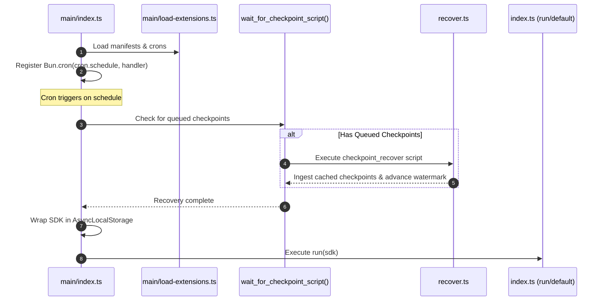
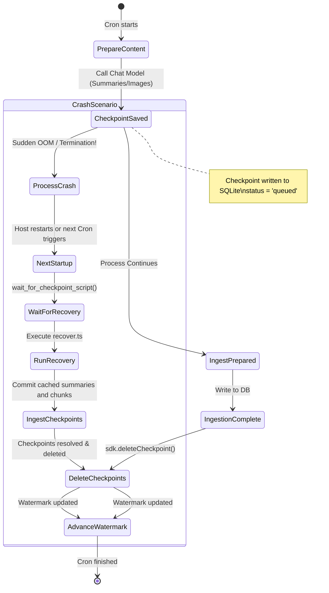
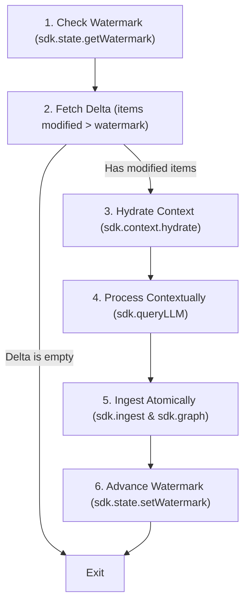
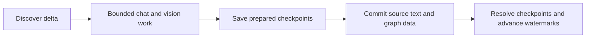

# Shale Extension System Architecture & Developer Guide

The Shale Extension System is a modular, event-driven, and cron-capable framework designed to ingest, process, and enrich diverse data streams into a unified SQLite knowledge layer with BM25 full-text search and evidence-backed knowledge graph relationships.

This document details every layer of the extension architecture, from configuration schemas to crash recovery checkpoints and the unified SDK.

---

## Table of Contents

1. [Architectural Overview](#1-architectural-overview)
2. [Extension Discovery & Directory Structure](#2-extension-discovery--directory-structure)
3. [The Extension Manifest: `manifest.json`](#3-the-extension-manifest-manifestjson)
4. [Configuration: `settings.json` & `settings.help.json`](#4-configuration-settingsjson--settingshelpjson)
5. [The Settings CLI & Interactive TUI](#5-the-settings-cli--interactive-tui)
6. [The Shale SDK (`@shale/sdk`)](#6-the-shale-sdk-shalesdk)
   - [Ambient Context & Auto-Discovery](#ambient-context--auto-discovery)
   - [State Management (`sdk.state`)](#1-state-management-sdkstate)
   - [Context Hydration (`sdk.context`)](#2-context-hydration-sdkcontext)
   - [Unified Ingestion (`sdk.ingest`)](#3-unified-ingestion-sdkingest)
   - [Knowledge Graph Ingestion (`sdk.graph`)](#4-knowledge-graph-ingestion-sdkgraph)
   - [Checkpoints & Crash Recovery (`sdk.checkpoint`)](#5-checkpoints--crash-recovery-sdkcheckpoint)
   - [Chat LLM Client (`sdk.llm`)](#6-chat-llm-client-sdkllm)
   - [Full-Text Search (`sdk.search`)](#7-full-text-search-sdksearch)
   - [Universal Logger (`sdk.logger`)](#8-universal-logger-sdklogger)
   - [Cross-Extension Messaging (`sdk.messages`)](#9-cross-extension-messaging-sdkmessages)
7. [Cron Scheduling & Dynamic Script Execution](#7-cron-scheduling--dynamic-script-execution)
8. [Checkpoints & Crash Recovery Architecture](#8-checkpoints--crash-recovery-architecture)
9. [Ingestion Pipelines: Push vs. Pull](#9-ingestion-pipelines-push-vs-pull)
   - [Push Model: HTTP Webhook & `QueueManager`](#push-model-http-webhook--queuemanager)
   - [Pull Model: Cron Delta Ingestion SOP](#pull-model-cron-delta-ingestion-sop)
10. [Bounded Chat Batches and Transactional Finalization](#10-bounded-chat-batches-and-transactional-finalization)
11. [End-to-End Case Study: Obsidian Extension](#11-end-to-end-case-study-obsidian-extension)

---

## 1. Architectural Overview

Shale strictly decouples host runtime infrastructure from extension logic:

```mermaid
graph TD
    subgraph Host ["Shale Host Runtime (main/)"]
        Loader["load-extensions.ts"]
        CronRunner["Bun.cron & runCron()"]
        HttpServer["Bun.serve (/ingest)"]
        Queue["QueueManager (ingest-queue.ts)"]
        Router["ingestRouter (ingest-router.ts)"]
    end

    subgraph Core ["Database Layer (lib/)"]
        DB["SQLite (data/production.db)"]
        FTS["FTS5 (chunks_fts)"]
        GraphDB["Graph (entities & edges)"]
        StateDB["extension_state & checkpoints"]
    end

    subgraph Extensions ["Extensions Directory (extensions/)"]
        ObsidianExt["extensions/obsidian/"]
        OtherExt["extensions/<custom-extension>/"]
    end

    subgraph SDK ["Shale SDK (@shale/sdk)"]
        ALS["AsyncLocalStorage Scope"]
        Submodules["state | context | ingest | graph | checkpoint | search | llm"]
    end

    Loader -->|Scans manifest.json| Extensions
    Loader -->|Registers crons| CronRunner
    Loader -->|Registers hooks| Router
    HttpServer -->|Enqueues items| Queue
    Queue -->|Dispatches| Router
    Router -->|Calls subscribe()| Extensions
    CronRunner -->|Executes index.ts| Extensions
    Extensions -->|Uses abstractions| SDK
    SDK -->|Commits transactions| Core
```

- **Host Runtime ([`main/`](file:///home/munch/Projects/shale/main)):** Scans extension folders, registers cron jobs with Bun, runs the HTTP ingest webhook on port 7425, and routes inbound payloads through an asynchronous FIFO queue.
- **Core Storage ([`lib/`](file:///home/munch/Projects/shale/lib)):** Single SQLite database ([`data/production.db`](file:///home/munch/Projects/shale/data/production.db)) with WAL journal mode, BM25 search via SQLite `fts5`, relational entity-graph tables, an `extension_state` key-value store, and a `checkpoints` crash recovery table.
- **Shale SDK ([`sdk/`](file:///home/munch/Projects/shale/sdk)):** Typesafe abstraction layer that extensions import via `@shale/sdk`. Extensions never write raw SQL queries; they invoke SDK services that manage transactions and entity deduplication.
- **Extensions ([`extensions/`](file:///home/munch/Projects/shale/extensions)):** Autonomous modules containing manifest declarations, configurable settings, cron routines, ingestion hooks, and recovery scripts.

---

## 2. Extension Discovery & Directory Structure

Every extension lives in its own subdirectory inside [`/extensions/<name>/`](file:///home/munch/Projects/shale/extensions). 

### Standard Extension Folder Layout

```text
extensions/my-extension/
├── manifest.json         # Extension identity, cron schedules, recovery scripts
├── settings.json         # Runtime user configuration (hot-reloaded from disk)
├── settings.help.json    # Validation schemas, defaults, constraints, and CLI help
├── settings.types.ts     # TypeScript interfaces matching settings.json
├── index.ts              # Default cron runner script
├── recover.ts            # Checkpoint recovery script invoked on crash recovery
└── [other modules...]    # Parsers, chunkers, formatters
```

### Discovery Logic

Extension discovery is performed in [`main/load-extensions.ts`](file:///home/munch/Projects/shale/main/load-extensions.ts#L23-L76). At startup:
1. Bun scans `extensions/**/manifest.json` using `new Glob("**/manifest.json")`.
2. The manifest is validated against [`isTExtensionManifest`](file:///home/munch/Projects/shale/lib/extension.ts#L20-L48).
3. The extension's namespace is mapped into [`extensionNamespaces`](file:///home/munch/Projects/shale/main/load-extensions.ts#L21).
4. If `checkpoint_recover` is specified, its absolute path is cached in [`checkpointRecoverScripts`](file:///home/munch/Projects/shale/main/load-extensions.ts#L20).
5. If `subscribe_ingest` is specified, the host imports the handler module, invokes its optional `init()` hook, and registers `subscribe()` in [`subscribe_ingest`](file:///home/munch/Projects/shale/main/load-extensions.ts#L19).
6. If `crons` are specified, each cron path is resolved relative to the extension folder and appended to [`crons`](file:///home/munch/Projects/shale/main/load-extensions.ts#L18).

---

## 3. The Extension Manifest: `manifest.json`

The [`manifest.json`](file:///home/munch/Projects/shale/extensions/obsidian/manifest.json) file declares the metadata and entrypoints for an extension.

### Schema Definition

The manifest types and validation rules are defined in [`lib/extension.ts`](file:///home/munch/Projects/shale/lib/extension.ts):

```typescript
// lib/extension.ts
export type CronExtension = {
  name?: string;
  schedule: string;        // Cron expression e.g. "0 0 * * *" or "*/15 * * * *"
  script: string;          // Relative path to cron script, e.g. "index.ts"
  run_on_startup?: boolean; // Run once after all extensions are loaded
  extensionId?: string;    // Injected automatically by host
  namespace?: string;      // Injected automatically by host
};

export type ExtensionManifest = {
  name: string;                // Unique identifier for the extension
  version: string;             // Semver string (e.g. "0.1.0")
  description: string;         // Human-readable summary
  namespace?: string;          // Graph & data namespace (defaults to name)
  setup_script?: string;       // Optional one-time initialization script
  subscribe_ingest?: string;   // Entry module for push ingestion hook
  checkpoint_recover?: string; // Recovery script run when queued checkpoints exist
  crons?: CronExtension[];     // Array of scheduled cron definitions
};
```

### Real-World Example: Obsidian Extension Manifest

From [`extensions/obsidian/manifest.json`](file:///home/munch/Projects/shale/extensions/obsidian/manifest.json):

```json
{
  "name": "obsidian parser",
  "version": "0.0.1",
  "description": "A parser for Obsidian markdown files.",
  "namespace": "obsidian",
  "checkpoint_recover": "recover.ts",
  "crons": [
    {
      "name": "obsidian-parser-cron",
      "script": "index.ts",
      "schedule": "0 0 * * *"
    }
  ]
}
```

---

## 4. Configuration: `settings.json` & `settings.help.json`

Shale provides a dual-file configuration model that pairs live runtime values with strict metadata and CLI documentation.

### 1. `settings.json` (Live Runtime State)

- Stored in the extension's root directory (e.g. [`extensions/obsidian/settings.json`](file:///home/munch/Projects/shale/extensions/obsidian/settings.json)).
- **Zero In-Memory Caching:** [`SettingsManager`](file:///home/munch/Projects/shale/sdk/settings.ts#L11-L110) in [`sdk/settings.ts`](file:///home/munch/Projects/shale/sdk/settings.ts) reads `settings.json` freshly from disk via [`getAll()`](file:///home/munch/Projects/shale/sdk/settings.ts#L60-L76) on **every single call**.
- **Runtime Hot-Reload:** Users can edit `settings.json` manually or via CLI while the server is running. Next time a function checks a setting, it immediately sees the updated value without needing a restart.
- **Resilient Fallback:** If `settings.json` is missing or temporarily contains invalid JSON during editing, [`SettingsManager.getAll()`](file:///home/munch/Projects/shale/sdk/settings.ts#L60-L76) logs a warning and returns fallback default values rather than crashing.

### 2. `settings.help.json` (Metadata, Constraints & Documentation)

- Stored adjacent to `settings.json` (e.g. [`extensions/obsidian/settings.help.json`](file:///home/munch/Projects/shale/extensions/obsidian/settings.help.json)).
- Defines types, documentation, defaults, valid ranges, allowed enum options, and examples for every setting.
- Schema defined in [`scripts/settings.ts`](file:///home/munch/Projects/shale/scripts/settings.ts#L7-L20):

```typescript
// scripts/settings.ts
export interface SettingHelpItem {
  type: "boolean" | "number" | "string" | "string[]" | "array" | "object" | string;
  description: string;
  default?: any;
  possibleValues?: any[];
  range?: { min?: number; max?: number };
  examples?: any[];
}

export interface SettingsHelp {
  extension: string;
  settings: Record<string, SettingHelpItem>;
}
```

### Excerpt from Obsidian `settings.help.json`

```json
{
  "extension": "obsidian",
  "settings": {
    "includeMarkdown": {
      "type": "boolean",
      "description": "Whether to discover and process markdown notes (.md).",
      "default": true,
      "possibleValues": [true, false]
    },
    "atomicNoteCharLimit": {
      "type": "number",
      "description": "Maximum character length for an atomic note.",
      "default": 600,
      "range": { "min": 50, "max": 9999999 }
    },
    "imageExtensions": {
      "type": "string[]",
      "description": "Recognized image file extensions for discovery.",
      "default": ["png", "jpg", "jpeg", "webp", "gif", "svg", "bmp", "tiff"]
    }
  }
}
```

---

## 5. The Settings CLI & Interactive TUI

Shale includes a built-in CLI and Terminal User Interface (TUI) tool at [`scripts/settings.ts`](file:///home/munch/Projects/shale/scripts/settings.ts) configured in [`package.json`](file:///home/munch/Projects/shale/package.json#L9) as `bun run settings`.

### CLI Commands

```bash
# List all extensions and their settings status
bun run settings list-extensions

# View all active settings for an extension
bun run settings list obsidian

# Inspect a single setting value
bun run settings get obsidian atomicNoteCharLimit

# Update a setting with automatic schema validation against settings.help.json
bun run settings set obsidian atomicNoteCharLimit 1500

# View parameter documentation, ranges, and allowed values
bun run settings describe obsidian atomicNoteCharLimit

# Reset a setting (or all settings) back to defaults defined in settings.help.json
bun run settings reset obsidian atomicNoteCharLimit
bun run settings reset obsidian

# Launch interactive @clack/prompts TUI
bun run settings tui
bun run settings tui obsidian
```

### Validation & Coercion Engine

When `settings set` is called, [`parseAndValidateValue`](file:///home/munch/Projects/shale/scripts/settings.ts#L147-L255) checks the input against `settings.help.json`:
- **Booleans:** Accepts `"true"`, `"false"`, `"1"`, `"0"`, `"yes"`, `"no"`.
- **Numbers:** Parses floats/ints, enforces `range.min` and `range.max`, checks `possibleValues`.
- **Arrays & String Arrays:** Parses JSON arrays `["a", "b"]` or comma-separated lists `"a, b"`.
- **Enums:** Rejects strings not present in `possibleValues`.

---

## 6. The Shale SDK (`@shale/sdk`)

The SDK ([`sdk/index.ts`](file:///home/munch/Projects/shale/sdk/index.ts)) is the developer abstraction layer that empowers extensions to run queries, store state, index data, and query LLMs without touching raw SQL.

### Ambient Context & Auto-Discovery

Extensions can obtain an SDK instance in two ways:
1. **Direct Factory:** [`createExtensionSDK(extensionId, namespace)`](file:///home/munch/Projects/shale/sdk/index.ts#L244-L262).
2. **Ambient Discovery:** [`getSDK()`](file:///home/munch/Projects/shale/sdk/index.ts#L378-L435) or by importing the dynamic proxies directly:
   ```typescript
   import { settings, state, ingest, checkpoint, logger } from "@shale/sdk";
   ```

#### Resolution Precedence in [`getSDK()`](file:///home/munch/Projects/shale/sdk/index.ts#L378-L435):
1. **`AsyncLocalStorage` Store:** Active `ShaleSDK` running in [`sdkStorage`](file:///home/munch/Projects/shale/sdk/index.ts#L277) (set automatically by [`runCron`](file:///home/munch/Projects/shale/main/index.ts#L156) or [`runWithSDK`](file:///home/munch/Projects/shale/sdk/index.ts#L282-L284)).
2. **Global/Lexical `shared.sdk`:** Available when executing in-memory transpiled cron scripts.
3. **Nearest `manifest.json`:** [`findNearestManifest`](file:///home/munch/Projects/shale/sdk/index.ts#L299-L335) walks upward from the caller's directory ([`detectCallerDir`](file:///home/munch/Projects/shale/sdk/index.ts#L340-L367)) or `process.cwd()`.
4. **Fallback SDK:** A default instance scoped to `"default"`.

---

### SDK Submodules Breakdown

#### 1. State Management (`sdk.state`)
- **File:** [`sdk/state.ts`](file:///home/munch/Projects/shale/sdk/state.ts) -> [`StateManager`](file:///home/munch/Projects/shale/sdk/state.ts#L5-L120)
- **Database Table:** `extension_state (extension_id, state_key, value, updated_at)` in [`lib/db-init.ts`](file:///home/munch/Projects/shale/lib/db-init.ts#L94-L102).
- **Isolation:** Every operation is scoped automatically to the extension's `extensionId`.
- **Methods:**
  - [`get(key: string): string | null`](file:///home/munch/Projects/shale/sdk/state.ts#L20-L33)
  - [`set(key: string, value: string): void`](file:///home/munch/Projects/shale/sdk/state.ts#L38-L52)
  - [`delete(key: string): boolean`](file:///home/munch/Projects/shale/sdk/state.ts#L57-L67)
  - [`getWatermark(key?: string): string | null`](file:///home/munch/Projects/shale/sdk/state.ts#L73-L75)
  - [`setWatermark(value: string, key?: string): void`](file:///home/munch/Projects/shale/sdk/state.ts#L80-L82)
  - [`getJson<T>(key: string): T | null`](file:///home/munch/Projects/shale/sdk/state.ts#L88-L96)
  - [`setJson<T>(key: string, value: T): void`](file:///home/munch/Projects/shale/sdk/state.ts#L101-L103)
  - [`getAll(): ExtensionStateRecord[]`](file:///home/munch/Projects/shale/sdk/state.ts#L108-L119)

#### 2. Context Hydration (`sdk.context`)
- **File:** [`sdk/context.ts`](file:///home/munch/Projects/shale/sdk/context.ts) -> [`ContextHydrator`](file:///home/munch/Projects/shale/sdk/context.ts#L5-L70)
- **Database Function:** [`getChronologicalChunks`](file:///home/munch/Projects/shale/lib/db.ts#L459-L478)
- **Purpose:** Fetches the most recent chunks previously ingested for a source (e.g. document URI or chat thread) ordered by `chunk_index ASC`.
- **Methods:**
  - [`getRecentChunks(sourceIdOrUri: string, limit?: number): HydratedChunk[]`](file:///home/munch/Projects/shale/sdk/context.ts#L19-L36)
  - [`hydrate(sourceIdOrUri: string, limit?: number): HydratedContext`](file:///home/munch/Projects/shale/sdk/context.ts#L45-L69): Returns metadata, chunks, and a pre-joined `combinedText` block ready for LLM prompt context injection.

#### 3. Unified Ingestion (`sdk.ingest`)
- **File:** [`sdk/ingest.ts`](file:///home/munch/Projects/shale/sdk/ingest.ts) -> [`UnifiedIngestor`](file:///home/munch/Projects/shale/sdk/ingest.ts#L9-L166)
- **Database Function:** [`addSourceWithChunks`](file:///home/munch/Projects/shale/lib/db.ts#L140-L213)
- **Purpose:** Atomically writes a source document, its chunked text, graph associations, and full-text search index in a single SQLite transaction.
- **Triggers:** Automatically updates `chunks_fts` (FTS5) upon replacement.
- **Method:**
  - [`sourceAndChunks(input: IngestSourceAndChunksInput): IngestSourceAndChunksResult`](file:///home/munch/Projects/shale/sdk/ingest.ts#L24-L165)

```typescript
sdk.ingest.sourceAndChunks({
  source: {
    type: "markdown_note",
    uri: "file:///path/to/note.md",
    origin: "obsidian",
    title: "Quantum Computing",
  },
  chunks: [
    {
      chunk_index: 0,
      text_content: "Qubits and superposition...",
      entity_names: ["Quantum Computing", "Qubit"], // Optional provenance link
    }
  ],
  namespace: "obsidian"
});
```

#### 4. Knowledge Graph Ingestion (`sdk.graph`)
- **File:** [`sdk/graph.ts`](file:///home/munch/Projects/shale/sdk/graph.ts) -> [`GraphIngestor`](file:///home/munch/Projects/shale/sdk/graph.ts#L5-L122)
- **Database Tables:** `entities (id, namespace, name, type)` and `edges (source_entity_id, target_entity_id, relation, weight)` in [`lib/db-init.ts`](file:///home/munch/Projects/shale/lib/db-init.ts#L125-L146).
- **Features:** Entity namespacing prevents collision across extensions. Automatically resolves string identifiers to internal SQLite integer row IDs.
- **Method:**
  - [`ingest(options: IngestGraphOptions): IngestGraphResult`](file:///home/munch/Projects/shale/sdk/graph.ts#L20-L121)

```typescript
sdk.graph.ingest({
  namespace: "obsidian",
  entities: [
    { name: "Quantum Computing", type: "Note" },
    { name: "Superposition", type: "Concept" }
  ],
  edges: [
    { source: "Quantum Computing", target: "Superposition", relation: "REFERENCES", weight: 1.0 }
  ]
});
```

#### 5. Checkpoints & Crash Recovery (`sdk.checkpoint`)
- **File:** [`sdk/checkpoint.ts`](file:///home/munch/Projects/shale/sdk/checkpoint.ts) -> [`CheckpointManager`](file:///home/munch/Projects/shale/sdk/checkpoint.ts#L11-L218)
- **Database Table:** `checkpoints (id, extension_id, checkpoint_key, data, created_at, status)` in [`lib/db-init.ts`](file:///home/munch/Projects/shale/lib/db-init.ts#L105-L119).
- **Purpose:** Temporarily queues expensive intermediate data (e.g. LLM outputs) to disk before database ingestion. Enables instant recovery without re-calling models if an OOM or crash occurs.
- **Methods:**
  - [`save<T>(data: T, optionsOrKey?: string | SaveCheckpointOptions): CheckpointItem<T>`](file:///home/munch/Projects/shale/sdk/checkpoint.ts#L44-L92)
  - [`getQueue<T>(): CheckpointItem<T>[]`](file:///home/munch/Projects/shale/sdk/checkpoint.ts#L97-L106)
  - [`getContext<T>(): CheckpointContext<T>`](file:///home/munch/Projects/shale/sdk/checkpoint.ts#L162-L174)
  - [`hasQueued(): boolean`](file:///home/munch/Projects/shale/sdk/checkpoint.ts#L143-L149)
  - [`delete(idOrKey: string): boolean`](file:///home/munch/Projects/shale/sdk/checkpoint.ts#L179-L186)
  - [`resolve(id: string): boolean`](file:///home/munch/Projects/shale/sdk/checkpoint.ts#L191-L193)
  - [`clear(): number`](file:///home/munch/Projects/shale/sdk/checkpoint.ts#L198-L206)

#### 6. Chat LLM Client
- **Chat LLM ([`sdk/llm.ts`](file:///home/munch/Projects/shale/sdk/llm.ts)):** [`sdk.queryLLM(prompt | options)`](file:///home/munch/Projects/shale/sdk/index.ts#L167-L180) connects to `/v1/chat/completions` with support for system instructions, images (URLs or base64 data URIs), and token controls.

#### 7. Full-Text Search (`sdk.search`)
- **File:** [`sdk/search.ts`](file:///home/munch/Projects/shale/sdk/search.ts) -> [`ChunkSearcher`](file:///home/munch/Projects/shale/sdk/search.ts)
- **Search Modes:**
  1. **BM25 (`sdk.search.bm25`):** Full-text keyword search with automatic stopword removal and highlighted `<mark>` preview snippets.

#### 8. Universal Logger (`sdk.logger`)
- **File:** [`sdk/logger.ts`](file:///home/munch/Projects/shale/sdk/logger.ts) -> [`Logger`](file:///home/munch/Projects/shale/sdk/logger.ts#L14-L82)
- Automatically prepends the extension name to all console output:
  ```text
  [obsidian parser] Discovering vaults...
  [obsidian parser] Force processing all vaults (ignoring watermarks).
  ```

#### 9. Cross-Extension Messaging (`sdk.messages`)
- **Files:** [`lib/messages.ts`](file:///home/munch/Projects/shale/lib/messages.ts) -> [`MessageBus`](file:///home/munch/Projects/shale/lib/messages.ts), [`sdk/messages.ts`](file:///home/munch/Projects/shale/sdk/messages.ts) -> [`ExtensionMessages`](file:///home/munch/Projects/shale/sdk/messages.ts), [`lib/messages.types.ts`](file:///home/munch/Projects/shale/lib/messages.types.ts)
- **Purpose:** Decoupled inter-extension communication supporting both point-to-point request/response queries and publish/subscribe broadcast events.
- **Features:**
  - **Arbitrary Channels:** Send and receive custom events and queries on any string topic (`sdk.messages.request("my:query", data)`, `sdk.messages.publish("my:event", data)`).
  - **Type-Safe Built-in Channels:** Compile-time parameter and return type inference for core system channels:
    - `file:process`: Unified file parsing returning chunks and graph entities/edges.
    - `file:can-process` & `files:can-process`: Discovers which loaded extension can process a given file or batch of files.
    - `files:process` (alias `file:process-batch`): Bulk file parsing with bounded chat preparation and transactional ingestion.
    - `source:ingested`: Event emitted when any source document is committed to SQLite.
    - `graph:link-entities`: Request cross-extension entity connections.
    - `content:summarize` & `content:summarize-batch`: Centralized text summarization via LLM.
    - `system:backup`: Trigger database backups on demand.
    - `search:query`: Cross-extension full-text search queries.
  - **Predicate & Priority Routing:** Handlers can register with `canHandle: (req) => boolean` and `priority: number`.
  - **Lifecycle Registration:** Extensions register handlers in `setup_script` (e.g. `setup.ts`), invoked automatically during startup in `load-extensions.ts`.

```typescript
// Sending a file processing request from an extension (e.g. Obsidian)
const response = await sdk.messages.request("file:process", {
  filePath: "/vault/architecture.png",
  fileType: "image",
  contextEntity: "Vault: Engineering",
  options: { namespace: "obsidian" }
});

// Registering a file processor handler in an extension (e.g. process-image)
sdk.messages.handle(
  "file:process",
  async (req) => processImageFile(req, sdk),
  {
    name: "process-image",
    priority: 10,
    canHandle: (req) => req.fileType === "image" || canProcessImage(req.filePath)
  }
);
```

---

## 7. Cron Scheduling & Dynamic Script Execution

The Shale host runs cron jobs configured in extension manifests using native Bun primitives.



### Execution Flow in [`main/index.ts`](file:///home/munch/Projects/shale/main/index.ts):

1. **Scheduling ([`main/index.ts:L197-L201`](file:///home/munch/Projects/shale/main/index.ts#L197-L201)):**
   ```typescript
   for (const cron of crons) {
     Bun.cron(cron.schedule, async () => {
       await runCron(cron);
     });
   }
   ```
2. **Immediate Execution CLI Flag ([`main/index.ts:L203-L206`](file:///home/munch/Projects/shale/main/index.ts#L203-L206)):**
   Starting the server with `--run-all-cron` runs all registered extension crons sequentially upon launch:
   ```bash
   bun main/index.ts --run-all-cron
   ```
3. **Startup crons:** A cron with `run_on_startup: true` runs once automatically
   when the host starts. The browser extension uses this to drain its durable
   ingest inbox immediately, rather than waiting for the first 15-minute tick.
4. **Execution Function ([`runCron`](file:///home/munch/Projects/shale/main/index.ts#L145-L189)):**
   - Calls [`wait_for_checkpoint_script(extensionId, cron)`](file:///home/munch/Projects/shale/main/index.ts#L101-L143). If uncommitted checkpoints exist from a prior crash, the cron runner holds and executes recovery first.
   - Instantiates a scoped `ShaleSDK` instance using [`createExtensionSDK`](file:///home/munch/Projects/shale/sdk/index.ts#L244-L262).
   - Enters the `AsyncLocalStorage` scope via [`sdkStorage.run(sdk, ...)`](file:///home/munch/Projects/shale/main/index.ts#L156).
   - Dynamically imports the script. It supports `export async function run(sdk)` or `export default async function(sdk)`.
   - If dynamic import fails, it falls back to in-memory TypeScript compilation via `Bun.Transpiler` and executes via `new AsyncFunction("shared", jsCode)({ sdk })`.

---

## 8. Checkpoints & Crash Recovery Architecture

Long-running ingestions that invoke external LLMs or process thousands of files are vulnerable to interruptions (OOM kills, process aborts, network disconnections). 

Shale’s checkpointing architecture prevents lost work:



### The Checkpoint Lifecycle:

1. **Saving During Processing:**
   In [`extensions/obsidian/process-vaults.ts:L306-L329`](file:///home/munch/Projects/shale/extensions/obsidian/process-vaults.ts#L306-L329), when a note expansion or image summary is generated via LLM, the result is saved immediately:
   ```typescript
   sdk.saveCheckpoint(
     {
       type: "ai_summary",
       vault: { name: vault.name, path: vault.path },
       filePath,
       noteTitle: fileResult.parsedFile.noteTitle,
       parsedFile: fileResult.parsedFile,
       entities: fileResult.entities,
       edges: fileResult.edges,
       mtime: statSync(filePath).mtimeMs,
     },
     { id: `ai_summary:${filePath}`, key: `ai_summary:${filePath}` }
   );
   ```
2. **Normal Resolution:**
   Once finalization commits the chunks to SQLite, it calls [`sdk.deleteCheckpoint(\`ai_summary:${note.filePath}\`)`](file:///home/munch/Projects/shale/extensions/obsidian/process-vaults.ts#L434).
3. **Crash Recovery Execution:**
   If the process died before finalization:
   - Next time `runCron()` triggers, [`wait_for_checkpoint_script`](file:///home/munch/Projects/shale/main/index.ts#L101-L143) detects uncommitted rows via [`hasQueuedCheckpoints`](file:///home/munch/Projects/shale/lib/db.ts#L411-L419).
   - An in-flight lock map (`inFlightRecoveries`) prevents duplicate recovery runs across overlapping cron tasks.
   - The extension's `checkpoint_recover` script (e.g. [`extensions/obsidian/recover.ts`](file:///home/munch/Projects/shale/extensions/obsidian/recover.ts#L20-L145)) runs:
     1. Fetches queued checkpoints via `sdk.getCheckpointContext()`.
     2. Commits the sources and chunks to SQLite.
     3. Advances the vault watermark timestamp in `sdk.state`.
     4. Calls `context.resolve(checkpoint.id)`.
   - The cron script proceeds immediately afterward, skipping already-recovered notes because the watermark was advanced!

---

## 9. Ingestion Pipelines: Push vs. Pull

Shale extensions can receive data via push webhooks or pull data on schedules.

### Push Model: HTTP Webhook & `QueueManager`

For real-time event streaming from external services (e.g. webhooks, browser extensions, messaging bots):

1. **HTTP Ingestion Endpoint ([`main/index.ts:L20-L35`](file:///home/munch/Projects/shale/main/index.ts#L20-L35)):**
   A Bun server accepts `POST /ingest` payloads matching [`IngestMaterial`](file:///home/munch/Projects/shale/lib/ingest.types.ts#L2-L12):
   ```typescript
   export interface IngestMaterial {
     target_processor: string; // Target extension name
     content: string;
     metadata: {
       connector: string;
       data_origin: string;
       time?: number;
     };
   }
   ```
2. **Asynchronous Ingest Queue ([`lib/queue.ts`](file:///home/munch/Projects/shale/lib/queue.ts)):**
   Inbound items enter [`ingestQueue`](file:///home/munch/Projects/shale/main/ingest-queue.ts), managed by [`QueueManager`](file:///home/munch/Projects/shale/lib/queue.ts#L15-L170). The queue ensures sequential, non-blocking FIFO dispatch to registered workers.
3. **Ingest Router ([`main/ingest-router.ts`](file:///home/munch/Projects/shale/main/ingest-router.ts)):**
   Inspects `item.target_processor` and dispatches the payload to the extension's exported `subscribe()` function registered in `subscribe_ingest`.

---

### Pull Model: Cron Delta Ingestion SOP

Every pull-based extension follows the **6-Step Stateless SOP**:



1. **Check Watermark:** Read the cursor for the target resource:
   ```typescript
   const lastMtime = Number(sdk.state.getWatermark(`vault:${vaultPath}:mtime`) ?? "0");
   ```
2. **Fetch Delta:** Filter files modified since `lastMtime` using `statSync(path).mtimeMs`. If no files changed, exit early.
3. **Hydrate Context:** Retrieve recent historical context for continuity:
   ```typescript
   const priorContext = sdk.context.hydrate(fileUri, 3);
   ```
4. **Process Contextually:** Use `sdk.queryLLM()` to extract summaries, concepts, or entities. Checkpoint intermediate results.
5. **Ingest Atomically:** Commit sources, chunks, and graph edges via `sdk.ingest.sourceAndChunks()` and `sdk.graph.ingest()`.
6. **Advance Watermark:** Update watermark to `maxMtime` via `sdk.state.setWatermark(String(maxMtime))`.

---

## 10. Bounded Chat Batches and Transactional Finalization

Local chat and vision requests can be expensive, so the model coordinator bounds
concurrent requests and lets extensions reserve a shared local GPU resource for
a batch. A batch can checkpoint prepared output before finalization. Finalization
commits prepared source text, graph data, checkpoints, and watermarks in a
transaction. It does not switch to or call a second model.



Preparation may be retried from its saved checkpoint after a crash. Finalization
does not repeat completed chat work, and failed transactions leave prepared data
available for recovery.

---

## 11. End-to-End Case Study: Obsidian Extension

The Obsidian extension ([`extensions/obsidian/`](file:///home/munch/Projects/shale/extensions/obsidian)) is the reference implementation demonstrating all extension concepts:

| File | Purpose | Key Symbols / Functions |
|---|---|---|
| [`manifest.json`](file:///home/munch/Projects/shale/extensions/obsidian/manifest.json) | Extension metadata | `name`, `crons`, `checkpoint_recover` |
| [`settings.json`](file:///home/munch/Projects/shale/extensions/obsidian/settings.json) | Live configuration values | `includeMarkdown`, `atomicNoteCharLimit`, `dynamicTokenBase` |
| [`settings.help.json`](file:///home/munch/Projects/shale/extensions/obsidian/settings.help.json) | Parameter documentation & constraints | Defines types, min/max limits, descriptions |
| [`vault-finder.ts`](file:///home/munch/Projects/shale/extensions/obsidian/vault-finder.ts) | System vault discovery | [`discoverVaults()`](file:///home/munch/Projects/shale/extensions/obsidian/vault-finder.ts#L39-L115), [`getObsidianConfigPath()`](file:///home/munch/Projects/shale/extensions/obsidian/vault-finder.ts#L29-L31) |
| [`parser.ts`](file:///home/munch/Projects/shale/extensions/obsidian/parser.ts) | Frontmatter & wikilink parsing | [`parseNoteContent()`](file:///home/munch/Projects/shale/extensions/obsidian/parser.ts#L39-L93), [`isImageFile()`](file:///home/munch/Projects/shale/extensions/obsidian/parser.ts#L101-L108) |
| [`chunker.ts`](file:///home/munch/Projects/shale/extensions/obsidian/chunker.ts) | Structural heading chunker | [`dynamicChunkNote()`](file:///home/munch/Projects/shale/extensions/obsidian/chunker.ts#L29-L97) |
| [`parse-file.ts`](file:///home/munch/Projects/shale/extensions/obsidian/parse-file.ts) | Note expansion & contextual chunks | [`parseFile()`](file:///home/munch/Projects/shale/extensions/obsidian/parse-file.ts#L232-L308), [`expandNoteWithChatModel()`](file:///home/munch/Projects/shale/extensions/obsidian/parse-file.ts#L69-L167) |
| [`parse-image.ts`](file:///home/munch/Projects/shale/extensions/obsidian/parse-image.ts) | Multimodal image description (delegates to process-image via `file:process` messaging) | [`parseImageFile()`](file:///home/munch/Projects/shale/extensions/obsidian/parse-image.ts#L43-L107), [`describeImageWithChatModel()`](file:///home/munch/Projects/shale/extensions/obsidian/parse-image.ts#L23-L37) |
| [`ingest-file.ts`](file:///home/munch/Projects/shale/extensions/obsidian/ingest-file.ts) | Note & image DB ingestion | [`ingestFile()`](file:///home/munch/Projects/shale/extensions/obsidian/ingest-file.ts#L148-L235), [`ingestImageFile()`](file:///home/munch/Projects/shale/extensions/obsidian/ingest-file.ts#L244-L327) |
| [`process-vaults.ts`](file:///home/munch/Projects/shale/extensions/obsidian/process-vaults.ts) | Preparation and commit coordinator | [`prepareVault()`](file:///home/munch/Projects/shale/extensions/obsidian/process-vaults.ts#L223-L363), [`finalizeVault()`](file:///home/munch/Projects/shale/extensions/obsidian/process-vaults.ts#L370-L504) |
| [`recover.ts`](file:///home/munch/Projects/shale/extensions/obsidian/recover.ts) | Crash recovery runner | [`run()`](file:///home/munch/Projects/shale/extensions/obsidian/recover.ts#L20-L145) |
| [`index.ts`](file:///home/munch/Projects/shale/extensions/obsidian/index.ts) | Main entrypoint for cron | [`run()`](file:///home/munch/Projects/shale/extensions/obsidian/index.ts#L55-L101) |

---

## Summary Checklist for Building a New Extension

To build a new extension (e.g. `extensions/my-service`):

1. **Create Directory:** `mkdir extensions/my-service`
2. **Define Manifest:** Create [`manifest.json`](file:///home/munch/Projects/shale/extensions/obsidian/manifest.json) specifying `name`, `namespace`, `checkpoint_recover`, and scheduled `crons`.
3. **Configure Settings:** 
   - Write default keys in `settings.json`.
   - Write schema, documentation, types, and ranges in `settings.help.json`.
4. **Implement Stateless Logic:**
   - In `index.ts`, export `export async function run(sdk: ShaleSDK)`.
   - Check watermarks using `sdk.state.getWatermark()`.
   - Process updates and call `sdk.saveCheckpoint()` for expensive operations.
   - Commit atomic updates with `sdk.ingest.sourceAndChunks()` and `sdk.graph.ingest()`.
   - Delete checkpoints and advance watermarks with `sdk.state.setWatermark()`.
5. **Implement Recovery:**
   - In `recover.ts`, export `export async function run(sdk: ShaleSDK, context: CheckpointContext)`.
   - Complete uncommitted work, resolve checkpoints, and advance watermarks.
6. **Verify with CLI:**
   - Run `bun run settings list my-service` and `bun run settings tui my-service`.
   - Run tests or trigger via `bun main/index.ts --run-all-cron`.
