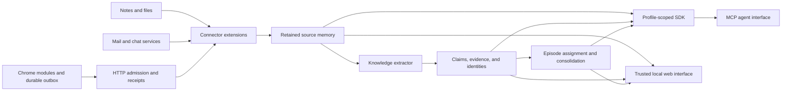

# Architecture

Shale runs a Bun/TypeScript host, a React web interface, and a collection of manifest-discovered extensions. Chrome modules and optional Python/exporter tools collect input outside the host. SQLite stores both retained knowledge and connector-private operational state. Chat and vision requests use configurable OpenAI-compatible endpoints, usually local ones.

## Runtime composition

[`main/index.ts`](../main/index.ts) composes the system. [`main/load-extensions.ts`](../main/load-extensions.ts) scans `extensions/**/manifest.json`, creates extension SDKs, executes setup modules, loads account providers and message handlers, registers ingestion subscribers, and expands cron paths. Loading the SDK initializes the configured database and additive schema setup.

In the normal daemon path, the host starts its dedicated MCP listener (default port `7427`), then the loopback web server (`7425`), and spawns [`scripts/graph-snapshot-worker.ts`](../scripts/graph-snapshot-worker.ts). The web server proxies MCP and serves the built UI, host APIs, knowledge APIs, and connector routes. MCP startup failure is logged; the web host can still start without an MCP gateway. The standalone `bun run mcp` listener defaults to `7426`.

Startup crons run after the interfaces are available. [`runStartupJobs`](../main/startup-crons.ts) starts independent extensions concurrently while preserving startup order within each extension. This is scheduling, not a dependency graph: downstream jobs may need another run before newly collected sources have been digested. Scheduled, startup, and manual executions share [`trackCronRun`](../main/cron-runs.ts), which coalesces overlap for the same cron object and records success/failure in memory. Cross-job/process exclusion requires durable extension leases.

The terminal console is opt-in with `--cli`; default interaction is through the browser. `--cron <name>` and `--run-all-cron` run work and exit. They still initialize the host and extensions, so they are not read-only inspection commands.

## SDK and extension boundary

[`createExtensionSDK`](../sdk/extension-sdk.ts) binds an extension ID, namespace, connection, settings directory, logger, message bus, credentials, state, checkpoints, models, source memory, graph, search, and knowledge editor. The ID scopes operational state; a namespace groups graph records. Neither is an access permission.

The runner calls an exported `run(sdk)` or default function inside an AsyncLocalStorage SDK scope. `getSDK()` supports ambient use, while explicit SDK arguments make tests and dependencies easier to understand. Cron execution checks queued checkpoints and invokes the manifest's recovery module before ordinary work.

Cross-extension request/response and events live in [`lib/messages/`](../lib/messages/) and [`sdk/messages.ts`](../sdk/messages.ts). Processors handle typed requests such as `file:process`; connectors publish `source:ingested` after committing. Event delivery is not the durable work queue. Periodic scans, state, and checkpoints provide recovery when notifications fail.

## Admission and collection

`POST /ingest` validates and routes envelopes by `target_processor`. [`admitIngest`](../main/ingest-admission.ts) calls a subscriber's durable `accept` hook when present. A `202` receipt then means input was durably admitted, not that a source is already searchable. Legacy subscribers enter an in-memory queue with `durable:false`.

Browser connectors keep a client IndexedDB outbox; delivery retries, receipts, and resumable jobs survive popup closure and service-worker restart. The host's connector worker converts admitted records into indexed source memories. Policies/status/retries are exposed under `/connectors/<name>/`. Site-specific extraction belongs in the extension's `chrome/` directory, bundled into the shared Chrome runtime.

File and service connectors can also collect directly on crons. Chat connectors share message storage, settled-window detection, summaries, graph commits, and refresh through `sdk/chat/`. Connector policy can admit, defer, or exclude a window before expensive summary work.

## Persistence and workload control

[`configureDatabaseConnection`](../lib/database-connection.ts) enables WAL, foreign keys, and a five-second busy timeout. Where work reads before writing, an immediate transaction reserves the writer before taking the read snapshot, avoiding SQLite read-to-write upgrade failures. Keep model/network calls outside that transaction. Independent processes can still contend for the writer; the timeout is bounded.

[`acquireTaskLease`](../lib/task-lease.ts) supplies persistent leases for workflows such as chat indexing, extraction, identity resolution, and episodes. Recovery acquires the extension lease before model work; it must not reserve a GPU while waiting on another job that needs that GPU to finish.

[`ModelCoordinator`](../lib/ai/scheduler.ts) coordinates configured local model resources within one process. Nested calls reuse their reservation, and chat batches bound preparation concurrency. It does not coordinate separate host processes sharing a GPU. Request deadlines, cancellation, retries, and provider batch state belong to the model layer; see [SDK model configuration](../sdk/MODELS.md).

## Consumers and trust

MCP readers are built on [`createScopedSDK`](../sdk/access.ts). Restricted profiles have a separate connection with materialized visible IDs and TEMP views shadowing tables. Unknown tables are empty by default; the connection is query-only. Writes use the shared writer through `sdk.knowledge`, with an access guard inside the transaction.

The web interface is the trusted local management surface. [`main/local-request.ts`](../main/local-request.ts) enforces local host/origin checks around host controls and knowledge inspection; it is not a per-user authorization system. MCP has bearer tokens, session/profile binding, and its own origin checks. Default unauthenticated MCP access uses the `local` profile; read [access control](access-control.md) before configuring an external consumer.

Graph display snapshots run in a separate worker so large graph serialization does not monopolize the host. The UI can poll snapshots and explicitly request fresh data. Search of source memory and search of displayed graph-node names are distinct: an agent-created entity may have no source chunks yet.
