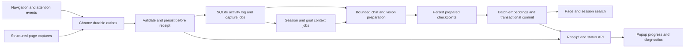

# Browser connector implementation plan

Reviewed 2026-10-01. Scope: the Chrome extension, browser ingestion extension, web-page parser, HTTP admission, queues, model scheduling, recovery, graph provenance, and relevant search interfaces. The baseline findings below are preserved from the initial review; implementation has now been added.

## Implementation status

Implemented 2026-10-01 in the working tree across all seven milestones:

- Durable host admission, shared nested validation, immutable receipts, capacity controls, and transactional legacy inbox migration.
- Chrome IndexedDB outbox, persisted destinations/retries/import cursors, preserved defaults, connection capability checks, and truthful popup states.
- Independent navigation/capture identities, document-bound extraction, SPA events, attention intervals, privacy filtering, and browser-instance scoping.
- Bounded worker wakeups, leases, strict chat-then-embedding batches, frozen checkpoints, atomic commits, and explicit retries for exhausted page/session failures.
- Shared Readability/semantic extraction, typed blocks/locators, bounded hydration, structural chunking, quality diagnostics, and optional vision/public fetching.
- Immutable indexed content versions tied to captures/events, historical passage retrieval, observed sessions, proposed research threads, explicit goals and corrections, late-event recomputation, filtered retrieval, and a small relevance baseline.
- Incremental catalog updates/removals, folder IDs/sequences, timestamp-tie diagnostics, optional labelled visit backfill, and separate opt-in public enrichment jobs.

A shared SQLite revision-trigger fix was also needed: source UPSERT conflict handling could override `INSERT OR IGNORE` inside a trigger when content returned to an earlier revision. Explicit trigger UPSERT clauses now preserve that revision safely.

See [browser server documentation](../../extensions/browser/README.md) and [Chrome setup and behavior](../../scripts/browser-chrome-extension/README.md). Generated artifacts are checked with `bun run browser:check`. The real Chromium harness uses an isolated profile/database and mocked model endpoints; it covers host-offline capture, service-worker termination, profile restart, popup closure, hydration, structured content and eventual indexed receipts. It does not establish performance on the user's live browser or real models.

Final implementation validation: `bun test` passed **461 tests**, with the opt-in Chromium test skipped in that run; `bun run test:browser:chrome` passed that test separately (**17 assertions**). `bun run typecheck`, `bun run browser:check`, and `git diff --check` also passed. The verification section below records the original review baseline.

History/backfill remains subject to Chrome enumeration limits, reported as incomplete when saturated or capped. No archive lookup, authenticated public enrichment, PDF capture, or site-specific adapters were introduced.

## Recommendation

Make delivery and the observed activity log reliable before adding richer inference. Preserve three independent concepts: page content, individual browsing events, and inferred research context. Repeated visits can reuse unchanged content, but must remain distinct events. A time-based browsing session can contain several goals, and a goal can continue across sessions.

Keep the existing local SQLite, typed message bus, evidence-backed graph, dynamic settings, and strict chat-then-embedding model scheduler. The current foundation supports incremental improvements; a connector rewrite is unnecessary.

## Current data flow

1. [background.js](../../scripts/browser-chrome-extension/background.js) listens for every tab's completed load, or receives a popup command. It injects [content.js](../../scripts/browser-chrome-extension/content.js), which selects the first `article`, `main`, or body and extracts text, capped HTML, links, and images.
2. Chrome posts an `IngestMaterial` envelope containing a JSON string to `/ingest`. A successful HTTP response increments “items sent”; the popup's connection test only checks `/health`.
3. [ingest-http.ts](../../main/ingest-http.ts) validates the outer envelope and routing target, then returns `202` after adding to the in-memory host queue. [subscribe.ts](../../extensions/browser/subscribe.ts) subsequently parses the inner payload and writes to the browser's durable inbox.
4. [ingest-queue.ts](../../extensions/browser/ingest-queue.ts) stores the entire inbox as a JSON array in one `extension_state` value, replacing pending single-page captures with the same normalized URL.
5. [index.ts](../../extensions/browser/index.ts) drains the inbox on the browser cron, groups single pages by URL again, prepares chat/vision work, and then embeds/commits. The [manifest](../../extensions/browser/manifest.json) schedules this every six hours and at host startup.
6. [page-ingest.ts](../../extensions/browser/page-ingest.ts) calls `web:parse`, analyzes the page, mutates active-session state during preparation, and saves a URL-keyed checkpoint. Finalization commits chunks and graph claims transactionally.
7. [session-manager.ts](../../extensions/browser/session-manager.ts) maintains one active session; [session-ingest.ts](../../extensions/browser/session-ingest.ts) summarizes visits and commits a session document. History and bookmarks have separate sources linked to canonical page entities.

## Findings and evidence

### Delivery, admission, and user feedback

| Priority | Finding | Code / consequence |
| --- | --- | --- |
| P0 | No durable Chrome outbox, retries, request timeout, or stable delivery ID. | `background.js:127` sends directly. Offline auto-captures are logged and lost; imports cannot resume safely after interruption. |
| P0 | HTTP acceptance precedes durable browser storage. | `main/ingest-http.ts:24`, `main/ingest-queue.ts`, and `lib/queue.ts`. A host crash or subscriber failure can lose already-acknowledged work. |
| P0 | Inner browser payloads have compile-time types but no runtime validator. | `subscribe.ts:34` casts parsed JSON; `compactPayload()` assumes `textContent` is a string. Exceptions are logged and swallowed after HTTP success. Unknown batch shapes can also reach processing. |
| P1 | “Connected” and “ingested” do not prove that content is searchable. | `/health` only reports the host; the popup has no durable receipt, processing status, or exclusion reason from the server. |
| P1 | Large tab/bookmark imports use a single request; history limits are silent. | `background.js:292`, `453`, `499`. Import caps are 5,000 records or 25,000 for “all”; there are no persisted cursors or byte-based batch limits. |
| P1 | Installation/update resets onboarding and counters. | `background.js:48` omits `totalIngestedCount` and `initialSyncCompleted` from the storage read, so defaults overwrite existing values. |
| P1 | Failures and exclusions are conflated. | `syncAllOpenTabs()` catches extraction errors as skips; full import can report success with skipped failures. The single-page popup reads `reason`, but the dispatcher returns exceptions in `error`. |

Chrome workers can be terminated while work is in progress, and globals do not survive worker shutdown. Long imports and retry state therefore need durable jobs, even though the current session ID is already persisted. [Chrome service-worker lifecycle](https://developer.chrome.com/docs/extensions/develop/concepts/service-workers/lifecycle).

These findings identify structural failure paths. They do not establish the cause of the user's particular live Chrome connection failure; that still needs an actual browser/server trace. The current outer payload and target name do match the host contract.

### Content extraction and model cost

| Priority | Finding | Code / consequence |
| --- | --- | --- |
| P1 | Root selection is simplistic and text serialization loses meaningful structure. | `content.js:31`, `69`: first matching root; whitespace flattened even in code; identical lines removed globally; no heading hierarchy or table representation. CSS-hidden content is not generally checked. |
| P1 | Supplied text bypasses HTML repair. | `web-page-parser/parser.ts:51–57` uses HTML only if text is absent. Browser preparation always supplies at least the title, so title-only fallback also prevents server fetching in this path. |
| P1 | Capture readiness is tied to load completion. | `background.js:242` has no explicit SPA navigation or bounded hydration recapture. Captures can miss content loaded later or associate events with a different document after navigation. |
| P1 | Truncation is unreported. | Text and HTML are sliced at 20,000 characters. HTML can end inside an element; batches bypass single-page inbox compaction. No quality, original-size, or truncation fields exist. |
| P1 | Every page requests images and may incur two text analyses. | `page-ingest.ts:54`, `95`; parser defaults to contextualization and up to eight sequential images, followed by browser page analysis. `enableLlmAnalysis=false` does not disable parser LLM/vision work. |
| P2 | Extraction diagnostics are absent. | Script injection failures silently become title-only captures; there is no extraction method, failure code, or quality score. Links/images are collected before clutter removal. |
| P2 | Chunking is duplicated and then repeated. | Parser chunks are joined and rechunked by `finalizePageVisit()`. The parser's long-sentence chunker lacks the browser chunker's hard size bound. Section context disappears. |

### Activity and context

| Priority | Finding | Code / consequence |
| --- | --- | --- |
| P0 | Deduplication discards actual visits. | `ingest-queue.ts:40`, `index.ts:48` coalesce by URL across tabs and session IDs. `session-manager.ts:151` replaces the same tab/URL even after intervening visits. |
| P1 | Navigation reconstruction compares adjacent global visits. | `navigation.ts:25`, `session-manager.ts:131`: tab 1 A, tab 2 X, tab 1 B loses the real A→B transition. Arrival/completion order can differ from navigation order. |
| P1 | Sessions describe page loads, not attention or goals. | All completed tabs are auto-captured, including background tabs. No activation, window focus, dwell intervals, tab groups, or explicit goal annotations are collected. “navigation” is assigned rather than observed as a Chrome transition. |
| P1 | One active server session cannot isolate collectors or concurrent contexts. | `active_session_state` is a singleton. Different explicit IDs force closure; the client and server have separate inactivity settings. Chrome never emits the supported `session_end`/`session_snapshot` payloads. |
| P1 | Session summaries see titles/URLs rather than page meaning. | `llm-enricher.ts:172` passes no page summaries, sections, or evidence of a goal. It asks for conclusions without evidence the user reached them. No topic threads or persistent goal model exist. |
| P1 | Advertised privacy settings are incomplete. | `excludePrivateBrowsing` is defined but unused, and incognito state is not sent. Client domain filtering differs from server URL-pattern filtering; server exclusions arrive too late for useful client feedback. |
| P2 | Canonicalization can merge distinct SPA routes. | `filter.ts:71` removes all fragments; useful hash routes need distinct identity from section anchors. Outbound graph references also use a different normalization path. |

### Scheduling, recovery, and resource bounds

| Priority | Finding | Code / consequence |
| --- | --- | --- |
| P1 | Capture-to-index delay can approach six hours before model time. | Inbox processing shares the session aggregator cron; accepting new work does not wake a worker. |
| P1 | Processing has no batch budget or browser task lease. | Whole-inbox preparation and a JSON-array inbox grow without limits. The model coordinator protects GPU phases, but is not durable job ownership, particularly with remote profiles or multiple processes. Existing `lib/task-lease.ts` can be reused. |
| P1 | Recovery lacks inbox-job linkage. | Page checkpoints use only URL; preparation mutates sessions before commit; recovery commits checkpoints without acknowledging the originating inbox jobs. The next drain can analyze the same job again. Partial batch failures retain already-prepared work. |
| P1 | Failed session preparation can discard active-session state. | `session-manager.ts:109–115` logs a closing-session error and still clears/replaces the active session. |
| P2 | Unchanged captures still repeat inference and embedding. | Source IDs are stable, but capture timestamps and generated text participate in indexed source hashes. There is no separate content fingerprint and analysis-version cache. |

The graph already preserves evidence revisions and marks inferred summaries/topics as proposals. Preserve this behavior. Existing page/history/bookmark source separation is also correct and should remain.

## Verification performed

Executed:

```sh
bun test tests/browser-extension.test.ts tests/browser-inbox.test.ts \
  tests/ingest-http.test.ts tests/web-page-parser-extension.test.ts \
  tests/connector-knowledge.test.ts
```

Result: **46 passed, 0 failed**. These tests validate important server behavior, including transactional graph writes, provenance, separate catalog sources, and model-phase ordering. They do not execute the shipped Chrome scripts. The HTTP integration test invokes the subscriber directly and does not test the host's actual in-memory queue boundary.

Six additional isolated review probes reproduced:

1. Same URL in two session IDs leaves only the second inbox entry.
2. A→B→A in one tab becomes two visits, with timestamps stored out of chronological order.
3. Interleaved tabs suppress a real same-tab navigation edge.
4. Missing `textContent` receives HTTP `202`, logs an error, and leaves no inbox item.
5. Supplied “Menu Login” text wins over useful article HTML.
6. Running Chrome's installation/update callback resets a stored count of 500 and completed onboarding.

These probes confirm defective behavior; they are not fixed-behavior regression tests. No live Chrome profile, real model endpoint, or production database was used for validation.

## Target design



### Core records

| Record | Identity and purpose |
| --- | --- |
| Collector | Persisted installation UUID, unique to the Chrome profile; browser-instance epoch prevents tab-ID reuse across restarts. |
| Activity event | Immutable event ID, collector sequence, event time, event kind, document/navigation identity, tab/window/opener information, optional session hint and attention interval. |
| Page capture | Capture ID, original/final/canonical URL, extraction version, structured blocks, metadata, content fingerprint, quality and truncation diagnostics. Links a capture to the event that requested it. |
| Page content version | Reusable content and analysis keyed by canonical identity, normalized content fingerprint, extraction/prompt/model versions. Visit timestamps do not force new content analysis. |
| Session | Observed activity window per collector, with ordered event membership and an explicit boundary reason. |
| Research thread / goal | Proposed topic/goal context linked to events and sessions, with evidence, confidence, classifier version, and optional user correction. |
| Processing job / receipt | Stable job ID, phase, checkpoint linkage, attempts, lease, next retry, terminal outcome, rejection/skip reason, and processing timestamps. |

Proposed versioned envelope fields: `protocolVersion`, `collectorId`, `batchId`, and records with stable `eventId`/`captureId`. Keep the existing `IngestMaterial` outer shape during migration. Generate a small Chrome-compatible contract/validator module from the shared TypeScript contract; CI must detect stale generated output. Do not duplicate independently maintained JS and TS schemas.

Delivery guarantees: retry transport at least once; persist each record once using unique IDs; treat an identical replay as a duplicate receipt; reject reuse of an ID with different content. “Received” means durable storage, while “indexed” means a completed searchable commit.

## Ordered implementation milestones

### 1. Durable server admission and protocol validation — P0

Add a fast optional `accept` export to registered ingest subscribers. The host awaits browser admission before returning a receipt. Keep the existing queued subscriber path for extensions such as `db-backup`, whose handler performs longer work. Admission must perform no model calls, and a browser request must not subsequently be enqueued a second time by the host.

Add runtime validation for every payload discriminant, nested record, finite timestamp, ID, URL, string length, count, and encoded byte size. Return structured errors before acknowledgement. Define whole-request validation with per-record accepted/duplicate/skipped outcomes after validation; skipped exclusions are terminal and explainable.

Replace the inbox blob with browser-owned SQLite rows and indexes for status/retry time/collector order. Admission atomically writes receipts and jobs. Add generic host capabilities and receipt-status routes backed by extension registration, so `main` does not import browser internals. Include loaded processor names and supported protocol versions in capabilities. Define `400/413/404/409/429/503` behavior and `Retry-After` where applicable.

Migrate `pending-ingest` transactionally, mark migrated records as legacy, and preserve only observations still present. Lost historical visits cannot be reconstructed from already-coalesced payloads. Keep the legacy reader until migration is verified.

**Acceptance:** crash after receipt and before processing loses no admitted records; invalid inner payloads never receive acceptance; replay after a lost response creates no duplicate job; server exclusion reasons reach the client. Test the real host route/queue integration, not just a direct subscriber call.

### 2. Chrome outbox, resumable operations, and truthful progress — P0

Store captures and import jobs in IndexedDB transactions before attempting HTTP delivery; use `chrome.storage.local` for small settings and collector identity. Persist retries and import-stage cursors. Use a single bounded delivery worker, alarms for wakeup, and serialized state updates. Recreate/check alarms on startup and worker initialization. Fix update defaults and repeated content-listener registration.

Use a configurable finite request timeout, exponential backoff with jitter, byte/count limits, and explicit retry classification. Network failures, `429`, and transient server failures retry; permanent validation/protocol errors are surfaced with a retry-after-correction action. Persist the destination associated with queued work so changing the server URL cannot silently redirect an old import.

Make popup commands create jobs and return IDs quickly. Render stored progress after reopening the popup: captured locally, waiting to send, received by server, indexing, indexed, skipped, or failed. Show queue depth, oldest unsent age, last meaningful error, and partial import counts. The connection test checks host identity, protocol support, and browser processor readiness. Preserve exact server error text where useful.

**Acceptance:** browse with the host offline, terminate the worker, restart it and the host, and eventually index all retained captures without duplicate events. Closing the popup does not cancel an import. Overload and storage limits are visible; silently dropping events is prohibited.

### 3. Immutable browsing activity and correct navigation — P0/P1

Separate navigation events from content capture and remove URL-based event coalescing. Repeated capture of one document may share content; distinct navigations always keep their own ID. Record event time when observed, rather than after extraction completes.

Add top-frame `webNavigation` events for committed navigation, history-state updates, and meaningful fragment-route changes. Retain `tabs.onUpdated` as a readiness signal rather than assigning every completion the semantic type “navigation.” Bind extraction to the expected document identity and verify the returned URL before persistence. Chrome exposes document IDs and SPA history-state notifications through this API. [Chrome webNavigation reference](https://developer.chrome.com/docs/extensions/reference/api/webNavigation).

Collect activation, window focus, visibility, and bounded dwell intervals without recording keystrokes or form input. Distinguish background loads from attended pages. Use the last relevant event per tab/document and observed opener/referrer relationships for navigation edges. Handle redirects, back/forward, reloads, tab closure, and tab-ID reuse explicitly.

Enforce incognito and exclusion rules before DOM extraction and durable storage; include flags for defensive server validation. Fetch server capture policy through a typed capability/policy interface, retaining local user overrides. Document offline policy behavior and re-evaluate exclusions after redirects. Keep canonical content URLs separate from route and section identities.

**Acceptance:** A→B→A preserves three events; interleaved tabs retain their own trails; unrelated tabs have no invented navigation edge; changing capture content does not change event identity. Private/excluded pages create no captured content. Out-of-order deliveries retain observed order.

### 4. Bounded processing and complete recovery — P1

Separate prompt indexing from infrequent session maintenance. Register a browser worker that wakes on durable admission, coalesces a short configurable collection window, and selects bounded jobs; retain a frequent cron as a recovery fallback. Keep HTTP admission independent of GPU availability.

Use `acquireTaskLease()` for browser worker ownership, renewal, and expired-job reclamation. Recheck settings and cancellation between jobs; avoid mutable session state during chat preparation. Make session membership an idempotent reduction over durable events, with multiple sessions keyed by collector rather than one global active object. Finalization failures retain the closing session.

Keep `sdk.models.batch()` as the execution boundary. Complete all chat/vision preparation for the selected batch and save versioned prepared output before any embedding call. Batch compatible chunk embeddings with explicit input limits, then commit each recoverable job transactionally. Checkpoints must be keyed by job/content version and record input IDs, phase, analysis settings, and generated output.

Commit sources, graph claims, job completion, and receipt outcome in the same SQLite transaction. Recovery reuses prepared output and completes the original job, so replay cannot call the LLM again. Isolate permanent failures; keep successful siblings; limit retry attempts and expose exhausted jobs. Renew leases around long model calls and verify ownership before committing.

**Acceptance:** inject failure after each durable boundary, including session reduction, preparation, embedding, graph commit, and acknowledgement. No successful work repeats inference; no job disappears. Overlapping workers cannot own the same job. Model traces prove zero embeddings during preparation and zero chat/vision calls during finalization.

### 5. Structured extraction and parser ownership — P1

Evaluate Mozilla Readability against a fixture corpus as the article extractor, operating on a cloned DOM. Retain a scored semantic-root fallback for documentation, tools, and non-article pages. Readability mutates its input and requires a DOM; browser-native parsing can avoid unnecessary server DOM work on every capture. [Mozilla Readability documentation](https://github.com/mozilla/readability).

Preserve typed blocks for headings, paragraphs, lists, tables, code, quotes, and figure captions, with heading paths and block locators. Preserve code whitespace and meaningful repeated lines. Extract author/date/language/canonical metadata and select links/images from retained content. Strip executable and sensitive attributes with an allowlist; if HTML is ever rendered, use an established sanitizer.

Use bounded hydration observation and document-bound recapture; avoid an unbounded mutation stream. Return extraction method/version, metadata-only versus full-content outcome, quality reasons, original lengths, and truncation status. Bound work by bytes, elements, time, and record count; truncate at complete block boundaries.

Have `web:parse` return normalized blocks, quality and chunk locators, not a second competing flattened representation. Score supplied text against HTML-derived candidates when extraction is poor. Server-fetch public pages only when explicitly enabled and needed, with timeout, response-size/content-type/redirect limits; retain live-DOM provenance separately from fetched content. Never assume it can reproduce logged-in pages or archived history.

Consolidate page summary/topics/category/retrieval context into one structured analysis call when the richer parser is available, keeping the browser's fallback for an absent parser. Respect an explicit text/vision analysis policy across the message request. Make image analysis optional, select meaningful diagrams/figures, and cache by asset/version. Preserve existing vision provenance and proposal status.

**Acceptance:** fixtures cover articles, documentation with code, tables, repeated passages, delayed SPA content, cookie banners, malformed HTML, lazy images, and restricted/metadata-only pages. Compare retained useful text, boilerplate, structure, time, and payload size against current extraction. All configured chunk/byte bounds hold; disabling LLM/vision issues no corresponding model requests.

### 6. Sessions, research threads, goals, and retrieval — P1/P2

Define observed sessions from attention/inactivity and explicit boundaries. Choose the server's policy as authoritative; Chrome's session ID becomes a hint. Finalize idle sessions through the bounded worker rather than waiting six hours. Keep navigation evidence independent of whether content parsing succeeds.

Build topic threads using observed tab groups, opener trails, attended intervals, bookmark folders, and cached page summaries/topics. Begin with deterministic grouping and a bounded LLM refinement. A session may contain multiple threads; a returning thread may span multiple sessions. Classify goals as tentative, with evidence event/capture IDs, confidence, and version. Do not claim the user reached a conclusion solely because pages were loaded.

Add an optional popup goal annotation (“Researching X”) and allow rename/merge/split corrections. Explicit user context has precedence over inferred context. Store inferred `HAS_TOPIC`, `HAS_GOAL`, `PART_OF_THREAD`, and thread summaries as proposals using the existing claim/evidence layer; store actual activity as observations. Use committed page analyses or prepared batch analyses as context inputs, without calling chat during the embedding phase.

Add bounded session/thread retrieval documents and a browser query interface for sessions, topic, goal, date range, collector, domain, and capture quality. Extend search only where required for filtering and ranking. Favor substantive captured passages over title-only catalog records and return source URL, section locator, session/goal explanation, and the distinction between quoted evidence and inferred context.

**Acceptance:** a fixture containing two interleaved research goals remains separable, and a later session can resume an existing goal. Queries such as “What was I investigating about SQLite last week?” return the relevant trail and passages. User corrections persist across recomputation; raw events do not change when labels change. Establish a small relevance benchmark before tuning ranking.

### 7. Incremental history and bookmark lifecycle — P2

Keep aggregate history records and bookmarks separate from rich page captures. Chrome `history.search()` reports page-level last visits; `getVisits()` can supply individual visit records for optional richer backfill. Label backfilled activity separately because it lacks live attention and DOM evidence. [Chrome history API](https://developer.chrome.com/docs/extensions/reference/api/history).

Persist import range and progress; add overlap/deduplication by browser history/visit IDs and report caps, cancellation, and incomplete ranges. Test timestamp ties before retaining the current `minVisitTime - 1` pagination: it can skip records at a boundary. Do not promise complete historical visits from a last-visit-only enumeration; document limitations or use a dedicated backfill strategy. Bound `getVisits()` work and filter visits by the requested interval.

Represent bookmark folders with collector-scoped Chrome folder IDs and parent IDs; labels are mutable metadata. Add bookmark create/move/update/remove and history removal handling with explicit retention semantics. Avoid deriving hierarchy from slash-separated names, which can be ambiguous and currently normalize differently between folder and ancestry entities.

Make public-page enrichment of history/bookmarks a separate opt-in capture job, with its own limits, quality label, and provenance. Archive lookup, authenticated fetching, PDFs, and site-specific adapters are later extensions to the typed processing contract.

**Acceptance:** interrupted import resumes without recounting accepted items; timestamp ties and limits are visible; duplicate URLs in different folders remain distinct bookmarks; moves/removals update current state while respecting retained evidence. Catalog resync cannot overwrite full page content.

## Atomic module boundaries

Keep entrypoints as wiring. Add modules only as milestones need them; avoid a general queue framework refactor as a prerequisite.

| Area | Proposed focused modules |
| --- | --- |
| Shared protocol | `lib/browser-contract.ts` for types; `lib/browser-validation.ts` for runtime validation; generated Chrome contract artifact. |
| Host | `main/ingest-admission.ts` for fast admission dispatch; `main/ingest-status.ts` for receipts/capabilities; retain HTTP parsing in `ingest-http.ts`. |
| Chrome | `background.js` for listeners; `capture.js` for document-bound capture; `outbox.js` for IndexedDB; `delivery.js` for transport; `import-jobs.js` for resumable orchestration; `history-sync.js` and `bookmark-sync.js` for catalog APIs; `activity.js` for attention/navigation; `popup.js` for rendering stored status. |
| Browser server | `storage-schema.ts`, `admission.ts`, `inbox-store.ts`, `activity-store.ts`, `worker.ts`, `session-reducer.ts`, `context-builder.ts`, and `retrieval.ts`; retain existing page/catalog/graph writers and reduce their orchestration responsibilities. |
| Parser | `readability.ts` for candidate selection; `blocks.ts` for structural normalization; `chunk-blocks.ts` for bounded chunks/locators; `parser.ts` for coordinating analysis and image delegation. |

Cross-extension calls remain typed message requests; browser code must not import parser/image extension implementations. Pair every new setting with types, help schema, default, and range. Read policy/settings at admission and job boundaries; freeze the analysis version/settings used by a prepared checkpoint so recovery remains reproducible.

## Rollout and completion criteria

1. Ship server protocol/admission and migration with legacy compatibility, then upgrade Chrome transport. Legacy receipts must not pretend to provide modern event deduplication guarantees.
2. Land event preservation before goal inference. Convert the six review probes into regression tests expecting corrected behavior in their respective milestones.
3. Add a Chrome-script mock harness and a real unpacked-extension Chromium integration harness. Run the latter against a temporary host/database and controlled fixture pages; include worker termination and popup closure. Select a supported Chromium build and verify required document-ID APIs in CI.
4. Gate richer extraction/context behind versioned settings while evaluating fixtures. Test rollback with the old reader; retain new SQLite tables and raw events rather than discarding them.
5. Track admission latency, unsent age, processing age, retry outcomes, metadata-only rate, extraction quality, model calls per content version, and retrieval relevance. Initial target: durable admission within 500 ms on an unloaded local host, bounded worker scheduling within one minute when capacity is available, and eventual completion after offline recovery. Model execution latency is measured separately.
6. Before release, run targeted regression suites, full Bun tests, type checks including Chrome/shared-contract artifacts, and real extension-to-host scenarios. No live model or browser success should be inferred from mocked Bun tests.

The first release should deliver durable receipts, offline recovery, preserved navigation events, visible processing state, and bounded indexing. Rich extraction follows; goal-aware retrieval becomes useful once it is built on trustworthy content and activity.
