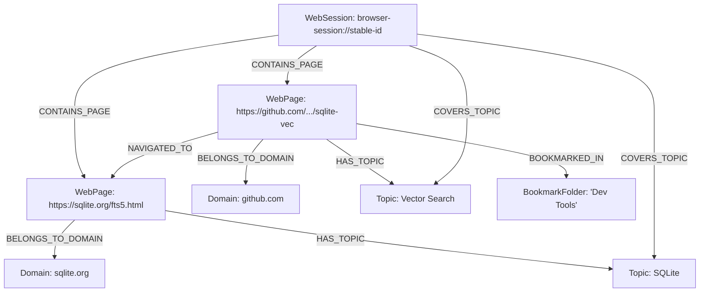

# Shale Browser Ingestion Extension

The **Shale Browser Ingestion Extension** ingests, embeds, enriches, and indexes a user's web browsing activity—including active web pages, browser history, bookmarks, and explicit session groupings—into the unified Shale SQLite knowledge layer.

---

## Features

- **Active Web Page Ingestion**: Ingests visited pages with title, clean body text, metadata, and full-text/vector index.
- **Canonical Graph Identity**: Uses normalized URLs for `WebPage` nodes and session URIs for `WebSession` nodes, so duplicate titles never merge unrelated records.
- **Privacy & Collision Avoidance Filters**:
  - Excludes social media platforms (`x.com`, `reddit.com`, `instagram.com`, `facebook.com`, `tiktok.com`, `linkedin.com`, `youtube.com`) to leave room for specialized social media ingestion extensions.
  - Excludes sensitive URLs (`*mail.google.com*`, `*accounts.google.com*`, `*bank*`, `*login*`).
  - Automatically strips URL tracking parameters (`utm_*`, `fbclid`, `gclid`).
- **Explicit Web Session Grouping**:
  - Clusters true navigation events within a single browsing session; snapshots and manual captures stay page-local.
  - Creates `WebSession` knowledge graph entities.
  - Links sequential navigation transitions (`Page A -> NAVIGATED_TO -> Page B`).
  - Links sessions to visited pages (`WebSession -> CONTAINS_PAGE -> WebPage`).
- **LLM Enrichment**:
  - Summarizes web pages and extracts 3-5 core conceptual topic nodes.
  - Synthesizes entire browsing sessions into descriptive narrative summaries with dominant topics.
- **Bookmarks & History**:
  - Ingests bookmark trees with folder hierarchies (`WebPage -> BOOKMARKED_IN -> BookmarkFolder`).
  - Ingests browser history batches with domain relationships.
  - Keeps bookmark/history sources separate from rich page captures while connecting them to the same canonical page node.
- **Crash Recovery**:
  - Uses the two-phase local GPU optimization pattern with checkpoints to guarantee zero lost LLM tokens during unexpected exits.
  - The host runs the browser cron once during startup, recovering checkpoints first and then draining every durable ingest item already queued.

---

## Configuration & Settings

Settings can be managed via the Shale Settings CLI:

```bash
# View all settings
bun run settings list browser

# Inspect a specific setting
bun run settings get browser excludeDomains
bun run settings describe browser sessionInactivityMinutes

# Update settings
bun run settings set browser excludeDomains '["x.com", "reddit.com", "facebook.com"]'
bun run settings set browser sessionInactivityMinutes 45

# Interactive TUI
bun run settings tui browser
```

### Key Settings

| Setting | Type | Default | Description |
|---|---|---|---|
| `excludeDomains` | `string[]` | Social media platforms | Domains to exclude from ingestion |
| `excludePatterns` | `string[]` | Sensitive/auth patterns | Wildcard URL patterns to exclude |
| `excludePrivateBrowsing` | `boolean` | `true` | Ignore private/incognito windows |
| `sessionInactivityMinutes`| `number` | `30` | Inactivity threshold before starting a new session |
| `enableLlmAnalysis` | `boolean` | `false` | Generate page/session summaries and topics |
| `generateSessionSummaries`| `boolean` | `true` | Synthesize browsing sessions into narrative summaries |
| `extractTopics` | `boolean` | `true` | Extract topic entities for the graph |
| `chunkSize` | `number` | `1000` | Target character chunk size for vectors |
| `namespace` | `string` | `"browser"` | Graph namespace |

---

## Knowledge Graph Schema


