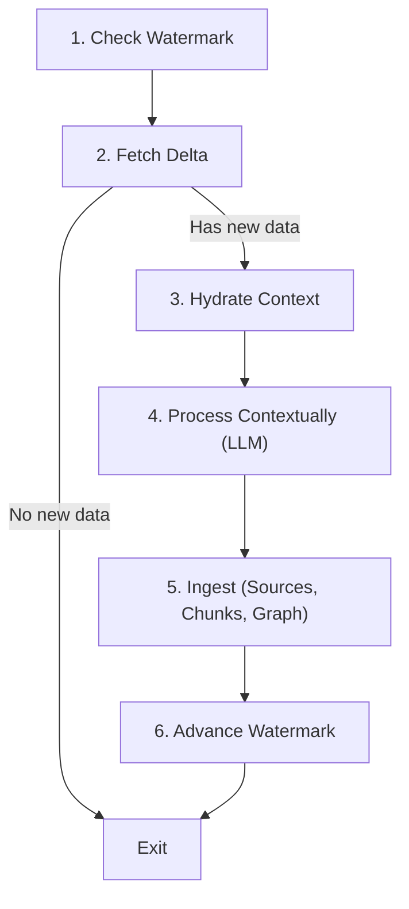

# Shale SDK

The Shale SDK is an abstraction layer that enables extensions (cron jobs, ingest handlers, processors) to interact safely with the Shale core data layer without manipulating raw SQL rows.

See [Cross-extension messages](MESSAGES.md) for routing, receiver scope, request cancellation, and subscription cleanup.

## Modules

### 1. State Management (`sdk.state`)

Scoped strictly to the extension's unique identifier (`extensionId`) to guarantee data isolation between extensions.

- `sdk.state.get(key: string): string | null`
- `sdk.state.set(key: string, value: string): void`
- `sdk.state.delete(key: string): boolean`
- `sdk.state.getWatermark(key?: string): string | null`
- `sdk.state.setWatermark(value: string, key?: string): void`
- `sdk.state.getJson<T>(key: string): T | null`
- `sdk.state.setJson<T>(key: string, value: T): void`
- `sdk.state.getAll(): ExtensionStateRecord[]`

### 2. Context Hydration (`sdk.context`)

Fetches the latest context for a source (such as a chat thread, document, or repository file) and orders it chronologically.

- `sdk.context.getRecentChunks(sourceIdOrUri: string, limit?: number): HydratedChunk[]`
- `sdk.context.hydrate(sourceIdOrUri: string, limit?: number): HydratedContext`
  - Returns metadata, the ordered chunks, and `combinedText` formatted for immediate LLM prompting.

### 3. Graph Ingestion (`sdk.graph`)

Safely ingests entities and relationships with namespacing, preventing term collisions across different extensions.

- `sdk.graph.ingest(options: IngestGraphOptions): IngestGraphResult`
  - Resolves internal integer IDs automatically from entity names.
  - Links edges between resolved entity IDs.

### 4. Unified Source & Chunk Ingestion (`sdk.ingest`)

Atomically commits a source document, its chunked text, in a single SQLite transaction.

- `sdk.ingest.sourceAndChunks(input: IngestSourceAndChunksInput): IngestSourceAndChunksResult`
  - Atomically writes to `sources`, `chunks`, and automatically updates `chunks_fts` (FTS5).

### 5. Model requests

Use `sdk.queryLLM` and `sdk.queryLLMBatch` for chat and vision requests. See [Model configuration and batches](MODELS.md).

### 6. Chunk Search (`sdk.search` / `search`)

#### BM25 Search (`mode: "bm25"`)

Performs full-text keyword search across chunks with sentence decomposition:

- Automatically breaks sentences into keywords, discarding common stopwords (e.g. 'of', 'and', 'the', 'in', etc.).
- Fuses results across all keywords using RRF, score summation, or disjunction.
- Provides snippet previews with `<mark>` highlight tags and reports matched keywords.

```typescript
const results = await sdk.search.bm25({
  query: "The architecture and performance of SQLite and Bun",
  limit: 10,
  keywordFusion: "rrf",
});
```

Standalone convenience functions:

- `searchBM25(options)`
- `searchChunks(options)` (unified entry point taking `{ mode: "bm25", ... }`)

### 7. Checkpoints & Crash Recovery (`sdk.checkpoint` / `checkpoint`)

Enables extensions to save temporary in-progress work to SQLite. If the process crashes mid-execution (OOM, sudden kill, exception), saved checkpoints queue up for crash recovery.

- `sdk.saveCheckpoint(data: any, key?: string): CheckpointItem`
- `sdk.getCheckpoints(): CheckpointItem[]`
- `sdk.getQueuedCheckpoints(): CheckpointItem[]`
- `sdk.getCheckpointContext(): CheckpointContext`
  - Returns `count`, `checkpoints`, `latest`, `earliest`, `clear()`, `resolve(id)`, `get(key)`
- `sdk.hasCheckpoints(): boolean`
- `sdk.clearCheckpoints(): number`
- `sdk.deleteCheckpoint(id: string): boolean`

#### Manifest Configuration (`checkpoint_recover`)

Extensions declare a `checkpoint_recover` script in `manifest.json`:

```json
{
  "name": "my-extension",
  "version": "1.0.0",
  "description": "...",
  "checkpoint_recover": "recover.ts",
  "crons": [ ... ]
}
```

#### Lifecycle & Cron Delay

1. If checkpoints are queued for an extension, its `checkpoint_recover` script runs automatically.
2. Context is provided to the script via `sdk.getCheckpointContext()` and `(sdk, context)` argument.
3. Any crons of that extension are delayed (`await wait_for_checkpoint_script`) until the recovery script finishes, and run right after.

---

## Phase 4: The Stateless Extension Workflow (SOP)

Every cron-based extension in the Shale ecosystem must adhere to the 6-step stateless lifecycle:



### Standard Implementation Example

> **Chat and message sources:** re-ingesting a URI *replaces* that source, and each source keeps a bounded memory (a summary plus at most 16 snippets). Don't append messages to one source per channel as the generic sketch below suggests. Use `@shale/sdk/chat` instead: it stores raw messages in connector-owned tables, cuts each conversation into time windows, and indexes one summarised source per window, with participants as graph `Person` entities. `extensions/discord` and `extensions/instagram` are reference implementations.

```typescript
// extensions/my-extension/index.ts
import { createExtensionSDK } from "@shale/sdk";

// When invoked by Shale cron runner, `shared.sdk` is provided automatically.
// Or instantiate directly:
const sdk = shared?.sdk ?? createExtensionSDK("my-extension");

export async function run() {
  // Step 1: Check Watermark
  const cursor = sdk.state.getWatermark("channel-general") ?? "0";

  // Step 2: Fetch Delta from external API
  const newItems = await fetchExternalMessages({ since: cursor });
  if (newItems.length === 0) {
    console.log("No new updates; exiting.");
    return;
  }

  // Step 3: Hydrate Historical Context
  const threadUri = "discord://channel/general";
  const context = sdk.context.hydrate(threadUri, 15);

  // Step 4: Process Contextually
  // Combine history + new items for LLM analysis (resolves pronouns, summaries, entities)
  const prompt = `History:\n${context.combinedText}\n\nNew Messages:\n${newItems.map((m) => m.text).join("\n")}`;
  const extracted = await callLLM(prompt);

  // Step 5: Ingest (Source, Chunks, and Graph)
  sdk.ingest.sourceAndChunks({
    source: {
      type: "chat_thread",
      uri: threadUri,
      origin: "discord",
      title: "Discord #general",
    },
    chunks: extracted.chunks.map((c) => ({
      text_content: c.text,
    })),
  });

  if (extracted.entities.length > 0) {
    sdk.graph.ingest({
      entities: extracted.entities,
      edges: extracted.edges,
    });
  }

  // Step 6: Advance Watermark
  const latestId = newItems[newItems.length - 1].id;
  sdk.state.setWatermark(latestId, "channel-general");
}
```
## Runtime and recovery guarantees

- Model request options accept an `AbortSignal`. File and web parser handlers pass message cancellation through to the model transport. GPU batches wait for outstanding chat requests before releasing their reservation.
- Recovery scripts own checkpoint resolution. Call `context.resolve(id)` only after committing that checkpoint's work; the host retains any unresolved rows, including partially completed batches.
- Source-linker saves complete candidate batches before analysis. `maxPairsPerRun` bounds analysis per invocation; remaining pairs persist for subsequent runs. Failed requests retain their work, and discovery watermarks advance only when the batch is complete.
- Source entities use `source:<source ID>` as their graph identity. Titles remain display labels. Ingesting an updated URI without an explicit ID preserves its existing source ID. Existing ambiguous title-based links cannot be reconstructed without re-analysis.
- HTTP ingest and visualizer servers bind to `127.0.0.1`. The visualizer rejects external origins and hostnames. Invalid ingest requests return non-success HTTP statuses; accepted requests return 202.
- `bun test` uses a temporary database via its preload. `SHALE_DB_PATH` overrides the database path for isolated tools/hosts. `bun run typecheck` checks host, tests, message contracts, and UI separately.
# Rich knowledge graph

The graph SDK supports entities with durable identity, scoped claims, source evidence,
events, review history, conflict discovery, bounded traversal, and graph-aware search.
See the [graph reference](graph/README.md) for examples and migration semantics.
