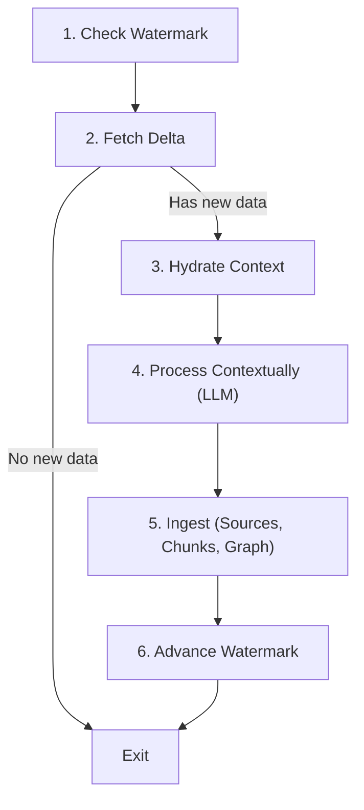

# Shale SDK

The Shale SDK is an abstraction layer that enables extensions (cron jobs, ingest handlers, processors) to interact safely with the Shale core data layer without manipulating raw SQL rows.

## Modules

### 1. State Management (`sdk.state`)

Scoped strictly to the extension's unique identifier (`extensionId`) to guarantee data isolation between extensions.

- `sdk.state.get(key: string): string | null`
- `sdk.state.set(key: string, value: string): void`
- `sdk.state.delete(key: string): boolean`
- `sdk.state.getWatermark(key?: string): string | null`
- `sdk.state.setWatermark(value: string, key?: string): void`
- `sdk.state.getJson<T>(key: string): T | null`
- `sdk.state.setJson<T>(key: string, value: T): void`
- `sdk.state.getAll(): ExtensionStateRecord[]`

### 2. Context Hydration (`sdk.context`)

Fetches the latest context for a source (such as a chat thread, document, or repository file) and orders it chronologically.

- `sdk.context.getRecentChunks(sourceIdOrUri: string, limit?: number): HydratedChunk[]`
- `sdk.context.hydrate(sourceIdOrUri: string, limit?: number): HydratedContext`
  - Returns metadata, the ordered chunks, and `combinedText` formatted for immediate LLM prompting.

### 3. Graph Ingestion (`sdk.graph`)

Safely ingests entities and relationships with namespacing, preventing term collisions across different extensions.

- `sdk.graph.ingest(options: IngestGraphOptions): IngestGraphResult`
  - Resolves internal integer IDs automatically from entity names.
  - Links edges between resolved entity IDs.

### 4. Unified Source & Chunk Ingestion (`sdk.ingest`)

Atomically commits a source document, its chunked text, and vector embeddings in a single SQLite transaction.

- `sdk.ingest.sourceAndChunks(input: IngestSourceAndChunksInput): IngestSourceAndChunksResult`
  - Atomically writes to `sources`, `chunks`, `vector_index` (vec0), and automatically updates `chunks_fts` (FTS5).

### 5. Vector Embeddings (`sdk.embed` / `embed`)

Generates vector embeddings using any OpenAI-compatible endpoint (OpenAI, Ollama, vLLM, LMStudio, etc.).

- `sdk.embed(text: string, options?: EmbedderOptions): Promise<number[]>`
- `sdk.embed(texts: string[], options?: EmbedderOptions): Promise<number[][]>`
- `embed(text | texts, options?: EmbedderOptions): Promise<number[] | number[][]>` (standalone function)

Configured via `.env`:

- `OPENAI_API_KEY`: API key for the embedding provider.
- `OPENAI_BASE_URL`: Base URL (default: `https://api.openai.com/v1`).
- `OPENAI_ENDPOINT`: Optional full endpoint URL (e.g., `https://api.openai.com/v1/embeddings`).
- `OPENAI_EMBEDDING_MODEL`: Model name (default: `text-embedding-3-small`).
- `EMBEDDING_DIMENSIONS`: Dimension normalization/padding (default: 4096 for SQLite vec0).

### 6. Chunk Search (`sdk.search` / `search`)

Provides high-performance search across ingested chunks across three distinct modes:

#### 1. Hybrid Search (`mode: "hybrid"`)

Combines vector embedding search and BM25 full-text search with configurable fusion of results:

- **Reciprocal Rank Fusion (RRF)**: default rank-based fusion with configurable `rrfK`, `vectorWeight`, and `bm25Weight`.
- **Linear Fusion**: weighted normalized score combination.
- **Custom Fusion**: user-provided scoring function receiving candidate ranks and scores.

```typescript
const results = await sdk.search.hybrid({
  query: "quantum computing principles",
  limit: 10,
  fusion: {
    strategy: "rrf",
    rrfK: 60,
    vectorWeight: 1.0,
    bm25Weight: 1.0,
  },
});
```

#### 2. Vector Embeddings Only Search (`mode: "vector"`)

Calculates similarity to a query string (auto-embedded via `sdk.embedder`), a raw vector, or a pre-existing chunk ID (K Nearest Neighbors). Computes and returns **cosine similarity** in results:

```typescript
// Similarity to a pre-existing chunk (KNN, excludes self by default)
const neighbors = await sdk.search.vector({
  chunkId: 42,
  limit: 5,
  excludeSelf: true,
});
// neighbors[0].cosineSimilarity is [-1, 1]
```

#### 3. BM25 Only Search (`mode: "bm25"`)

Performs full-text keyword search across chunks with sentence decomposition:

- Automatically breaks sentences into keywords, discarding common stopwords (e.g. 'of', 'and', 'the', 'in', etc.).
- Fuses results across all keywords using RRF, score summation, or disjunction.
- Provides snippet previews with `<mark>` highlight tags and reports matched keywords.

```typescript
const results = await sdk.search.bm25({
  query: "The architecture and performance of SQLite and Bun",
  limit: 10,
  keywordFusion: "rrf",
});
```

Standalone convenience functions:

- `searchHybrid(options)`
- `searchVector(options)`
- `searchBM25(options)`
- `searchChunks(options)` (unified entry point taking `{ mode: "hybrid" | "vector" | "bm25", ... }`)

---

## Phase 4: The Stateless Extension Workflow (SOP)

Every cron-based extension in the Shale ecosystem must adhere to the 6-step stateless lifecycle:



### Standard Implementation Example

```typescript
// extensions/my-extension/index.ts
import { createExtensionSDK } from "@shale/sdk";

// When invoked by Shale cron runner, `shared.sdk` is provided automatically.
// Or instantiate directly:
const sdk = shared?.sdk ?? createExtensionSDK("my-extension");

export async function run() {
  // Step 1: Check Watermark
  const cursor = sdk.state.getWatermark("channel-general") ?? "0";

  // Step 2: Fetch Delta from external API
  const newItems = await fetchExternalMessages({ since: cursor });
  if (newItems.length === 0) {
    console.log("No new updates; exiting.");
    return;
  }

  // Step 3: Hydrate Historical Context
  const threadUri = "discord://channel/general";
  const context = sdk.context.hydrate(threadUri, 15);

  // Step 4: Process Contextually
  // Combine history + new items for LLM analysis (resolves pronouns, summaries, entities)
  const prompt = `History:\n${context.combinedText}\n\nNew Messages:\n${newItems.map((m) => m.text).join("\n")}`;
  const extracted = await callLLM(prompt);

  // Step 5: Ingest (Source, Chunks, Vectors, and Graph)
  sdk.ingest.sourceAndChunks({
    source: {
      type: "chat_thread",
      uri: threadUri,
      origin: "discord",
      title: "Discord #general",
    },
    chunks: extracted.chunks.map((c) => ({
      text_content: c.text,
      embedding: c.vector,
    })),
  });

  if (extracted.entities.length > 0) {
    sdk.graph.ingest({
      entities: extracted.entities,
      edges: extracted.edges,
    });
  }

  // Step 6: Advance Watermark
  const latestId = newItems[newItems.length - 1].id;
  sdk.state.setWatermark(latestId, "channel-general");
}
```
